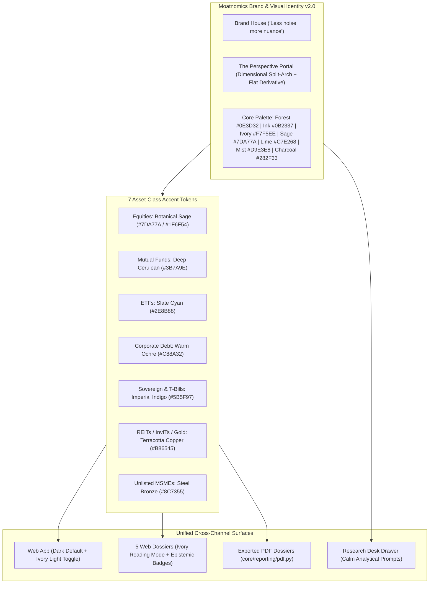

# Moatnomics Site-Wide Brand House & Visual Identity v2.0 Implementation Plan

> [!IMPORTANT]
> **Governing Mandates:**
> - **Brand House Territory:** *"Less noise, more nuance."* | **Promise:** *"Understand the evidence. Examine the trade-offs. Know what deserves a closer look."*
> - **Visual Operating Rules:** *"Nuance should make decisions clearer, not make the reader work harder."* & *"Make the evidence easier to understand, not easier to believe."*
> - **Canonical References:** [`docs/BRAND_HOUSE_AND_VOICE_GUIDE.md`](file:///Users/lyndonpinto/Documents/Stock_Research_App/docs/BRAND_HOUSE_AND_VOICE_GUIDE.md), [`docs/VISUAL_IDENTITY_AND_MOTION_GUIDE.md`](file:///Users/lyndonpinto/Documents/Stock_Research_App/docs/VISUAL_IDENTITY_AND_MOTION_GUIDE.md), [`docs/VISUAL_ARTIFACTS_INVENTORY.md`](file:///Users/lyndonpinto/Documents/Stock_Research_App/docs/VISUAL_ARTIFACTS_INVENTORY.md), and [`docs/BRAND_COPY_INVENTORY.md`](file:///Users/lyndonpinto/Documents/Stock_Research_App/docs/BRAND_COPY_INVENTORY.md).

> [!NOTE]
> **Status (20 Oct 2026, `main` @ `9aee965`):** Waves 1–5 shipped as the commits `613a71f`, `2b206e0`, `b413ed6` and `9aee965`. Still open: `og:image`/apple-touch wiring, referencing the hero and portal-plate files, and the copy rewrite (Decision #6), now tracked as *Track 3 — Language & Voice* (site copy first, then reports, then backend). The tagline decision (single tagline) is in `BRAND_HOUSE_AND_VOICE_GUIDE.md` → *Voice Decisions*.

---

## 1. Locked Architectural Decisions (From Interview)

| Decision Area | Locked Specification |
| :--- | :--- |
| **1. Theme Architecture** | **Dark Mode Default** (`Ink Navy #0B2337` & `Forest #0E3D32` surfaces with `Ivory #F7F5EE` text and `Lime #C7E268` focal CTAs) + **Persistent Header Toggle** to **Warm Ivory Light Mode** (`#F7F5EE` paper canvas, `#FFFFFF` elevated cards, `#0B2337` / `#282F33` ink) + **1-Click Ivory Reading Mode** inside long-form Research Dossiers. |
| **2. Unique Asset-Class Accent Palette** | **7 Earth & Mineral Editorial Accents** (applied to card top-borders, category pills, dossier masthead ribbons, and PDF cover stripes—kept distinct from semantic gain/loss indicators): • **Listed Equities:** Botanical Sage (`#7DA77A` dark / `#1F6F54` light) • **Mutual Funds:** Deep Cerulean / Cobalt (`#3B7A9E`) • **National ETFs:** Teal / Slate Cyan (`#2E8B88`) • **Corporate Debt & NCDs:** Warm Amber / Ochre (`#C88A32`) • **Sovereign Curve & T-Bills:** Imperial Indigo / Violet (`#5B5F97`) • **REITs, InvITs & SGBs:** Terracotta / Mineral Copper (`#B86545`) • **Unlisted MSMEs:** Steel Bronze / Oxide (`#8C7355`) |
| **3. Typography & Numeric Hierarchy** | • **Display / Editorial Serif (`--font-serif`):** `'Playfair Display'` (Google Fonts out-of-the-box, with `@font-face` hook ready for `'Tiempos Headline'`) for hero headlines, dossier titles, section openers, and pull quotes. • **Product / Body Sans (`--font-sans`):** `'Inter'` with mandatory `font-variant-numeric: tabular-nums` (`tnum`) across all prices, yields, weights, deltas, dates, and financial tables. • **Code / Identifiers (`--font-mono`):** `'JetBrains Mono'` for tickers, ISINs, Udyam UINs, and formulas. |
| **4. Vector SVGs vs. External Hero Art** | • **Authored in Code (Precision Vector SVGs):** The **Perspective Portal** dimensional split-arch symbol (with central vertical mirror prism), flat small-size (`16px–24px`) symbol, horizontal/stacked lockups, favicon, the **12 canonical `24×24px` (`1.75–2px` stroke) research icons**, **7 Pillar SVGs**, **10 Sector SVGs**, and **Research Desk glyphs**—eliminating all ~45 raw OS emojis. • **External Raster Slot Wiring (`.webp`):** Responsive `<picture>/` containers wired to `web/static/img/heroes/hero-*.webp` and `portal-*.webp` with graceful CSS/SVG Perspective Portal arch fallbacks until external images are dropped in. |
| **5. Web & PDF Dossier Unification** | All **5 Web Dossiers** (`dossier.html`, `fund_dossier.html`, `debt_dossier.html`, `reit_dossier.html`, `msme_dossier.html`) and **Exported PDFs** (`core/reporting/pdf.py` + MSME PDF export) share: • Forest/Ink Navy masthead with Perspective Portal mark + Asset-Class Accent Ribbon • Warm Ivory (`#F7F5EE`) reading/print canvas with `Playfair Display` headings & `Inter` tabular-numeral tables • Brand House callouts (*Executive Conclusion*, *Decision Snapshot*, *Countercase*, *Falsification Watchpoints*, and *Epistemic Badges*: `VERIFIED FACT`, `CALCULATION`, `INTERPRETATION`, `ASSUMPTION`, `UNCERTAINTY`) • Restyled **6-Part Chart Anatomy** in `Forest #0E3D32`, `Ink Navy #0B2337`, `Sage #7DA77A`, `Mist #D9E3E8`, and `Lime #C7E268`. |
| **6. Copy & Existing DB Reports** | Rewrite all ~55 UI/template/email/Copilot copy blocks to the Brand House voice (*"Less noise, more nuance."*) and implement a zero-token **Dossier Presentation Formatter** so all 84+ cached reports in `reports.db` render Decision Snapshots, Epistemic Badges, Countercase callouts, and Watchpoints automatically. |
| **7. Motion Choreography** | Implement v2.0 CSS timing tokens (`100–180ms` micro, `160–240ms` state, `220–360ms` drawer, `350–700ms` chart reveal) with `@media (prefers-reduced-motion: reduce)` guard, and replace the spinning synthesis shield in `#synthesizingOverlay` with the **4-Beat Perspective Portal SVG Reveal (`700–1,200ms`)** + `Context → Evidence → Implication` progress stages. |

---

## 2. Visual System & Token Architecture Diagram

---

## 3. Phased 5-Wave Execution Roadmap

### Wave 1: Design Token Architecture, Dual Theme (Dark/Light), Typography & 7 Asset-Class Accents
1. **[`web/static/css/style.css`](file:///Users/lyndonpinto/Documents/Stock_Research_App/web/static/css/style.css) & [`core/brand/visual_identity.py`](file:///Users/lyndonpinto/Documents/Stock_Research_App/core/brand/visual_identity.py)**
2. **[`web/templates/base.html`](file:///Users/lyndonpinto/Documents/Stock_Research_App/web/templates/base.html) & [`web/static/js/main.js`](file:///Users/lyndonpinto/Documents/Stock_Research_App/web/static/js/main.js)**

### Wave 2: "The Perspective Portal" SVG Logo System, `24×24px` Vector Icon Sprite & Zero-Emoji Sweep
1. **Brand Logo Master SVGs (`web/static/img/brand/` & `base.html`)**
2. **Canonical `24×24px` (`1.75–2px` stroke) Vector Sprite (`web/templates/base.html` & `web/static/img/{nav,pillars,sectors,ui}/`)**

### Wave 3: Homepage, 12 Asset Directories, Portal Hero Containers & Brand House Copy
1. **Hero Portal Framing & External Image Slots**
2. **Asset-Class Accent Wiring & Brand House Copy Across All 13 Pages**

### Wave 4: All 5 Web Dossiers, Zero-Token Presentation Formatter & 6-Part Chart Anatomy
1. **Unified Dossier Masthead & Warm Ivory Reading Mode**
2. **Zero-Token Dossier Presentation Formatter** (implemented in `core/analysis/parser.py` and `core/analysis/equity_dossier.py`; `core/reporting/editorial_formatter.py` was never created)
3. **Canonical 6-Part Chart Anatomy Wrapper**
4. **Research Desk (`copilot_modal.html` & `copilot.js`) Brand House Alignment**

### Wave 5: PDF Report Compiler Unification (`core/reporting/pdf.py`), MSME PDF Export, Emails & Final Verification
1. **Institutional PDF Dossier Overhaul ([`core/reporting/pdf.py`](file:///Users/lyndonpinto/Documents/Stock_Research_App/core/reporting/pdf.py))**
2. **Branded HTML Emails ([`core/notify.py`](file:///Users/lyndonpinto/Documents/Stock_Research_App/core/notify.py))**
3. **End-to-End Verification & Documentation Sync (`AGENTS.md` Rules 1, 3, 5, 6, 8)**
