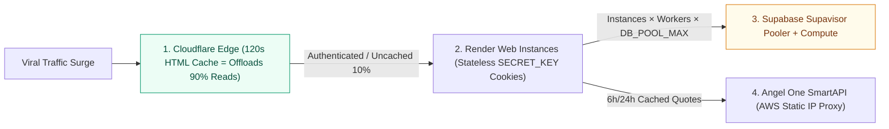

# BREAK GLASS IN CASE OF EMERGENCY — Traffic Surge & Crash Recovery Playbook

**Document Label:** `BREAK-GLASS EMERGENCY RUNBOOK (SEV-1)`  
**Canonical Repo Path:** [BREAK_GLASS_IN_CASE_OF_EMERGENCY.md](file:///Users/lyndonpinto/Documents/Stock_Research_App/docs/BREAK_GLASS_IN_CASE_OF_EMERGENCY.md)  
**Target Production Domain:** https://moatnomics.com  
**Primary Goal:** Restore live uptime within **3 minutes** and scale capacity **10x–50x within 10 minutes** without corrupting database state, user sessions, or live Razorpay payments.

> [!CAUTION]
> **TWO GOLDEN RULES DURING AN ACTIVE CRASH:**
> 1. **Do NOT start with a `git push`:** [render.yaml](file:///Users/lyndonpinto/Documents/Stock_Research_App/render.yaml#L5) runs `verify_reality_audit.py` + `pytest -q` (`941` tests, ~3 minutes) on every git build. Use **Cloudflare Edge Rules** (live in 15s) and **Render Dashboard Scaling / Env Overrides** first.
> 2. **Scale Supabase Connections BEFORE Scaling Render Workers:** If Render opens more connections than Supabase allows (`60` direct default), [`_get_raw_connection`](file:///Users/lyndonpinto/Documents/Stock_Research_App/core/db/connection.py#L356-L362) trips `_PG_AVAILABLE = False` for 60s and silently fails over each container to its local `reports.db` SQLite file (making logged-in users temporarily lose credits/unlocks).

---

## 0. 30-Second Symptom-to-Fix Triage Matrix

Check https://telemetry.betterstack.com and `curl -I https://moatnomics.com/healthz` first to identify which ceiling broke:

| Live Symptom | Exact Root Cause in Moatnomics | Immediate Fix (Jump To) |
| :--- | :--- | :--- |
| **Fast `HTTP 503 Service Unavailable`** | Uvicorn `--limit-concurrency 60` ceiling hit on single worker ([render.yaml](file:///Users/lyndonpinto/Documents/Stock_Research_App/render.yaml#L6)). | **Phase 1.1** (Cloudflare 120s Edge Cache) + **Phase 2.2** (Raise workers/instances). |
| **`HTTP 502 Bad Gateway` / Restart Loop (`Exit 137`)** | Container hit `2048 MB` RAM ceiling (`VmRSS` OOM during concurrent SSR/PDF/scheduler spikes). | **Phase 1.2** (`ENABLE_BACKGROUND_SCHEDULERS=0`) + **Phase 2.2** (Upgrade Render to **Pro 4 GB / 8 GB**). |
| **Users appear logged out / missing credits for ~60s** | Postgres `max_connections` exhausted → [`connection.py`](file:///Users/lyndonpinto/Documents/Stock_Research_App/core/db/connection.py#L357) flipped `_PG_AVAILABLE = False` (SQLite fallback). | **Phase 2.1** (Use Supavisor Pooler URL + upgrade Supabase Compute Add-on). |
| **`HTTP 429 Rate limit exceeded` on mobile networks** | `SlowAPI` `100/minute` per IP ([main.py](file:///Users/lyndonpinto/Documents/Stock_Research_App/web/main.py#L851)) saturated by shared carrier CGNAT (Jio/Airtel). | **Phase 1.1** (Cloudflare Edge Cache absorbs `GET` hits) + **Phase 2.2** (Multi-worker scaling). |
| **Email OTP sign-ups failing during surge** | Resend Free Tier `100 emails/day` cliff ([provider_quotas.py](file:///Users/lyndonpinto/Documents/Stock_Research_App/core/analytics/provider_quotas.py#L207)) or Supabase Auth rate limit. | **Phase 3.1** (Upgrade Resend to Pro `50,000/mo`; Google OAuth `/auth/google` unaffected). |
| **Crash started right after a recent `git push`** | Application regression (not traffic). | **Phase 4** (1-click Render image rollback in 45s or `./run.sh rollback`). |

---

## Architecture Bottleneck Map (Why Things Break & Order of Operations)



---

## PHASE 1: Stop the Bleeding & Get Back Online (Minutes 0–3)

### 1.1 Turn On Cloudflare Anonymous HTML Edge Caching (30 Seconds — Offloads ~90% of Load)
Most viral surges are anonymous readers opening `/`, `/equities`, or `/dossier/{ticker}`. Authenticated Moatnomics users carry [`USER_SESSION_COOKIE = "user_session_token"`](file:///Users/lyndonpinto/Documents/Stock_Research_App/web/common.py#L39) and admins carry [`ADMIN_COOKIE_NAME = "admin_session"`](file:///Users/lyndonpinto/Documents/Stock_Research_App/web/common.py#L37). Caching cookie-free `GET` pages at Cloudflare's edge drops Render CPU and Supabase reads by ~90% within 15 seconds while keeping logged-in sessions 100% live and personalized.

1. Open **Cloudflare Dashboard → `moatnomics.com` → Caching → Cache Rules → Create Rule**.
2. **Rule Name:** `BREAK-GLASS: Anonymous Public SSR 120s Cache`
3. Switch to **Edit expression** and paste verbatim:
   ```text
   (http.request.method eq "GET" and not http.cookie contains "user_session_token" and not http.cookie contains "admin_session" and not starts_with(http.request.uri.path, "/api/") and not starts_with(http.request.uri.path, "/auth/") and not starts_with(http.request.uri.path, "/admin") and not starts_with(http.request.uri.path, "/contact"))
   ```
4. **Cache status:** `Eligible for cache`
5. **Edge TTL:** *Ignore cache-control header and use this TTL* → **`2 minutes` (`120 seconds`)**
6. **Browser TTL:** *Respect origin TTL* (so browsers revalidate cleanly when you turn the rule off).
7. Click **Deploy**.
8. **If hit by malicious bots/scrapers (not organic readers):** Enable **Security → Settings → Under Attack Mode**, **AND** add a WAF Skip Rule for `http.request.uri.path in {"/api/razorpay-webhook" "/api/create-order" "/api/verify-payment" "/health" "/healthz"}` so Razorpay webhooks and uptime probes are never challenged.

### 1.2 Shed Background Daemons & Resuscitate Origin Container (90 Seconds)
When [`ENABLE_BACKGROUND_SCHEDULERS=1`](file:///Users/lyndonpinto/Documents/Stock_Research_App/render.yaml#L62-L63) is active, [`lifespan`](file:///Users/lyndonpinto/Documents/Stock_Research_App/web/main.py#L793-L803) launches 6 background loops inside the web container (including `+8s` AMFI/ETF catch-up and `+16s` fund look-through audits on every container boot). Turn them off during an incident so 100% of RAM, CPU, and DB sockets serve live visitors:

1. Open **Render Dashboard → `stock-research-app` → Environment**.
2. Change `ENABLE_BACKGROUND_SCHEDULERS` from `1` to **`0`** and click **Save Changes** (triggers a clean container restart without running the 3-minute git test build).
3. If the container is wedged prior to env save: click **Manual Deploy → Restart service**.
4. Verify origin heartbeat:
   ```bash
   curl -fsSI https://moatnomics.com/healthz
   ```

---

## PHASE 2: Scale Up Infrastructure 10x–50x (Minutes 3–10)

### 2.1 Step A — Expand Supabase PostgreSQL Capacity FIRST (2 Minutes)
In [`core/db/connection.py`](file:///Users/lyndonpinto/Documents/Stock_Research_App/core/db/connection.py#L227-L310), each Uvicorn worker maintains a `ThreadedConnectionPool(minconn=DB_POOL_MIN, maxconn=DB_POOL_MAX)` (`default 2..10`) and opens direct overflow sockets if all `10` slots are busy. Always obey:

$$\text{Render Instances} \times \text{Uvicorn Workers} \times \texttt{DB\_POOL\_MAX} \le 0.75 \times \text{Supabase Max Connections}$$

1. **Verify Connection Pooler DSN:**
   - In **Supabase Dashboard → Connect → Connection String → Transaction / Session Pooler**, confirm `SUPABASE_DB_URL` in Render uses the **Supavisor Pooler host** (`aws-0-<region>.pooler.supabase.com`, port `5432` Session Mode or `6543` Transaction Mode) rather than direct `db.<ref>.supabase.co:5432` (which hard-caps at `60` connections on small compute).
   - *Compatibility note:* `psycopg2` in [`connection.py`](file:///Users/lyndonpinto/Documents/Stock_Research_App/core/db/connection.py#L137-L151) uses client-side parameter interpolation rather than server-side `PREPARE` statements, and Supavisor Session Mode (`:5432`) also preserves session `SET TIME ZONE 'Asia/Kolkata'` (`200+` client connections).
2. **Upgrade Supabase Compute Add-on (if scaling past 2 Render instances):**
   - Go to **Supabase Dashboard → Project Settings → Compute and Disk**.
   - Upgrade Compute to **Medium (4 GB RAM / 2-core ARM)** (`120` direct / `400` pooler conns) or **Large (8 GB RAM / 2-core ARM)** (`240` direct / `800` pooler conns).
   - Update informational quota env vars in Render when convenient: `SUPABASE_MAX_CONNECTIONS=400`, `SUPABASE_STORAGE_LIMIT_MB=8192`.

### 2.2 Step B — Scale Render Compute Vertically & Horizontally (3 Minutes)
Because Moatnomics signs user and admin sessions using stateless HMAC-SHA256 cookies (`SECRET_KEY` in [`web/common.py`](file:///Users/lyndonpinto/Documents/Stock_Research_App/web/common.py#L240-L270)), **horizontal multi-instance scaling works immediately with zero sticky-session configuration**.

Apply one of the pre-calculated profiles below in **Render Dashboard → `stock-research-app`**:

| Parameter | Normal Baseline (Today) | **Surge Profile 1 (10x Traffic)** | **Surge Profile 2 (50x Mega-Surge)** |
| :--- | :--- | :--- | :--- |
| **Supabase Compute** | Micro / Small + Pooler | **Small / Medium** + Supavisor Pooler | **Large (8 GB)** + Supavisor Pooler |
| **Render Instance Plan** (*Settings → Instance Type*) | Standard (`2 GB` RAM, `1` vCPU) | **Pro (`4 GB` RAM, `2` vCPU)** | **Pro Plus (`8 GB` RAM, `4` vCPU)** |
| **Render Instance Count** (*Scaling → Manual / Autoscale*) | `1` instance | **`2` instances** | **`4` to `6` instances** (or Autoscale `2–8` @ `65%` CPU / `70%` RAM) |
| **Uvicorn `--workers`** | `1` | **`2`** (`4` total workers) | **`3`** (`12–18` total workers) |
| **Uvicorn `--limit-concurrency`** | `60` | **`150`** (`600` concurrent origin reqs) | **`200`** (`2,400–3,600` concurrent origin reqs) |
| **Render Env Vars** | `HOST_MEMORY_LIMIT_MB=2048`<br>`DB_POOL_MAX=10`<br>`ENABLE_BACKGROUND_SCHEDULERS=1` | `HOST_MEMORY_LIMIT_MB=4096`<br>`DB_POOL_MAX=12`<br>`ENABLE_BACKGROUND_SCHEDULERS=0` | `HOST_MEMORY_LIMIT_MB=8192`<br>`DB_POOL_MAX=12`<br>`ENABLE_BACKGROUND_SCHEDULERS=0` |
| **Peak Pooled DB Connections** | `10` | `2 × 2 × 12 = 48` | `6 × 3 × 12 = 216` (requires Supavisor) |

**Exact Copy-Paste Start Command Overrides** (*Render Dashboard → Settings → Build & Deploy → Start Command*):

- **Surge Profile 1 (`Pro 4 GB` × 2 instances):**
  ```bash
  uvicorn web.main:app --host 0.0.0.0 --port $PORT --workers 2 --limit-concurrency 150 --timeout-keep-alive 5 --proxy-headers --forwarded-allow-ips='*'
  ```
- **Surge Profile 2 (`Pro Plus 8 GB` × 4–6 instances):**
  ```bash
  uvicorn web.main:app --host 0.0.0.0 --port $PORT --workers 3 --limit-concurrency 200 --timeout-keep-alive 5 --proxy-headers --forwarded-allow-ips='*'
  ```

> [!IMPORTANT]
> **Memory Math per Worker:** Each Uvicorn worker holds ~180–260 MB resident memory plus [`PDF_SEMAPHORE = asyncio.Semaphore(4)`](file:///Users/lyndonpinto/Documents/Stock_Research_App/web/routers/dossier.py#L25) (~250 MB worst-case if 4 PDF exports run simultaneously). Never exceed `2` workers on a `4 GB` instance or `3` workers on an `8 GB` instance.

---

## PHASE 3: Raise External Provider Quotas Before Secondary Cliffs Hit (Minutes 8–15)

Check live utilization anytime at `https://moatnomics.com/admin?tab=ai-spends` (powered by [`get_all_provider_constraints`](file:///Users/lyndonpinto/Documents/Stock_Research_App/core/analytics/provider_quotas.py#L105-L343)):

1. **Transactional & OTP Email Cliff (Resend + Supabase GoTrue):**
   - **Risk:** Resend Free Tier hard-stops at **`100 emails/day`** (`3,000/mo`). During a sign-up spike, new Email OTP registrations and support ticket alerts (`/contact`) will bounce once 100 emails are sent.
   - **Action:** Upgrade **Resend** to **Pro (\$20/mo, `50,000 emails/mo`, no daily 100-email cap)** and set `EMAIL_DAILY_LIMIT=50000` in Render Environment. Confirm Supabase Dashboard → **Authentication → SMTP Settings** uses your custom Resend SMTP credentials (Google OAuth via `/auth/google` has no email cap and stays live regardless).
2. **Google Gemini API & Perplexity Failover (Paid Unlocks & Copilot Only):**
   - **Note:** All public SSR pages (`/`, `/equities`, `/dossier/{ticker}`, `/funds`, `/debt`, `/reits`, `/sovereign`, `/etfs`, `/msme`, `/compare`, `/calculator/tax`) consume **zero LLM tokens**.
   - **Action:** If paying users heavily trigger new ticker syntheses (`/api/generate`) or Research Desk Copilot chats, raise your Google Cloud / AI Studio monthly billing cap and bump `GEMINI_MONTHLY_BUDGET_USD` from `20.0` to `200.0` in Render Env Vars. Confirm `PERPLEXITY_API_KEY` (`50 req/min` Sonar failover) remains funded.
3. **Angel One SmartAPI + AWS Static IP Proxy (`YFINANCE_FALLBACK=0`):**
   - **Rule:** Keep **`YFINANCE_FALLBACK=0`** (never enable `yfinance`).
   - **Action:** SmartAPI allows `10 req/s` live quotes and `3 req/s` historical candles through `SMARTAPI_PROXY_URL`. Phase 1.1's `120s` Cloudflare Edge Cache + our 6-hour EOD candle cache ([`fundamentals.py`](file:///Users/lyndonpinto/Documents/Stock_Research_App/core/analysis/fundamentals.py#L1071-L1196)) and 24-hour L2 closing cache ([`equity_dossier.py`](file:///Users/lyndonpinto/Documents/Stock_Research_App/core/analysis/equity_dossier.py#L45-L90)) automatically protect this quota. Confirm the AWS proxy instance is `running` in EC2/Lightsail if market quotes stall.
4. **Razorpay Live Checkout (`25 req/s`):**
   - Confirm `/api/create-order`, `/api/verify-payment`, and `/api/razorpay-webhook` are **excluded** from Cloudflare caching and bot challenges. Inspect **Razorpay Dashboard → Developers → Webhooks** to verify `200 OK` delivery.

---

## PHASE 4: Code Regression Rollback (ONLY If Crash Was Triggered by a Bad Deploy)

If Better Stack logs (`https://telemetry.betterstack.com`) show Python `Traceback` exceptions starting immediately after a recent `git push` rather than traffic saturation:

1. **Fastest Recovery (45 Seconds — Render Cached Image Rollback):**
   - Open **Render Dashboard → `stock-research-app` → Events / Deploys**.
   - Find the last known-good deploy prior to the crash and click **Rollback to this deploy** (reuses the pre-built container image immediately, skipping the 3-minute `pytest` build).
2. **CLI Git & Checkpoint Rollback (Syncs Repository to Match):**
   ```bash
   ./run.sh checkpoints
   ./run.sh rollback
   ```
   *(Powered by [checkpoint_manager.py](file:///Users/lyndonpinto/Documents/Stock_Research_App/ci/checkpoint_manager.py).)*

---

## PHASE 5: Live Recovery Verification & Post-Surge Scale-Down Checklist

### 5.1 One-Command Recovery Verification
Run from any terminal to confirm edge caching, SSR dossier rendering, database health, and API latency are all nominal:

```bash
for path in /healthz / /equities /dossier/INFY /funds /calculator/tax; do
  printf "%-20s -> " "$path"
  curl -s -o /dev/null -w "HTTP %{http_code} | TTFB %{time_starttransfer}s | CF: %header{cf-cache-status}\n" "https://moatnomics.com${path}"
done
```
- **Target:** `HTTP 200` across all 6 paths, `TTFB < 0.50s` (`< 0.08s` when `CF: HIT`).

### 5.2 Safe Scale-Down Sequence (Once Traffic Returns to Baseline for >2 Hours)
Always scale down in **reverse order** (Compute FIRST, Schedulers SECOND, Database LAST):

1. **Render Compute:** Lower Instance Count back to `1` (or disable Autoscaling). If returning to the `2 GB` Standard tier, revert the Start Command override back to [render.yaml](file:///Users/lyndonpinto/Documents/Stock_Research_App/render.yaml#L6) (`--workers 1 --limit-concurrency 60`) and `HOST_MEMORY_LIMIT_MB=2048` **before** downgrading RAM so multi-worker processes do not OOM a 2 GB container.
2. **Re-enable Autonomous Schedulers:** Set `ENABLE_BACKGROUND_SCHEDULERS=1` in Render Environment so the 08:30 AM IST Stock Discovery @9AM cohort, 23:25 IST AMFI NAV/ETF sync, and nightly project audits resume on schedule.
3. **Cloudflare Edge Rule:** Either keep the anonymous Cache Rule active at a short **`30s` Edge TTL** (recommended permanent shield against micro-spikes) or toggle the Cache Rule **Off** in Cloudflare → *Cache Rules*. Disable *Under Attack Mode* if it was enabled.
4. **Database & Git Hygiene:** Keep `SUPABASE_DB_URL` on the Supavisor Pooler permanently. If any tier limits (`HOST_MEMORY_LIMIT_MB`, `SUPABASE_STORAGE_LIMIT_MB`, `DB_POOL_MAX`) remain upgraded permanently, update [render.yaml](file:///Users/lyndonpinto/Documents/Stock_Research_App/render.yaml) in git on `dev → main` so future blueprint syncs do not overwrite your live settings.
