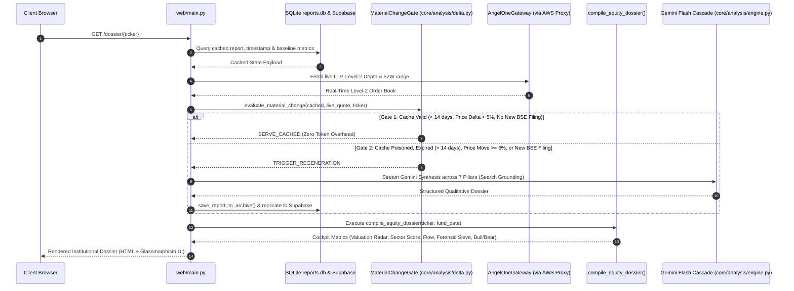
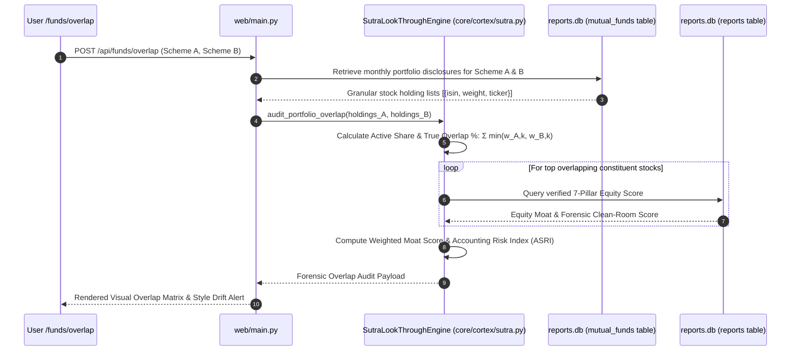

# Multi-Asset Institutional Report Evaluation Frameworks, Data Sources & Operational Flows Specification

**Document Identifier:** `docs/REPORT_EVALUATION_FRAMEWORKS.md`
**Document Version:** 3.8.0 | **Effective Date:** 2026-11-09
**Target System:** `Stock Research App` (`main` / `dev` branch)
**Compliance Standards:**
* SEBI (Research Analysts) Regulations, 2014 Section 2(u) — Factual Non-Advisory Safe Harbor
* SEBI (Mutual Funds) Regulations, 1996 & SEBI Categorization Circulars
* SEBI (Issue and Listing of Non-Convertible Securities) Regulations, 2021 & OBPP Master Directions
* SEBI (Real Estate Investment Trusts) Regulations, 2014 & SEBI (SM REITs Amendment) Regulations, 2024
* Reserve Bank of India (RBI) Financial Benchmark India (FBIL), DICGC Act 1961 Section 16(1) & NBFC-P2P Master Directions, 2024
* Income Tax Act, 1961 & Finance Act 2025 (Sections 115BAC, 80C, 80TTA, 80TTB, 80CCD(1B), 10(12), 10(12A), 194A, 50AA, 112A, 111A, 115UA, and 47(viic))

---

## Executive Summary & System Philosophy

Historically, the platform's evaluation framework was confined strictly to the **7 Pillars of Fundamental Equity Analysis** (evaluating business compounding, economic moats, governance, and cash flow durability).

As the platform evolved into an **Autonomous Multi-Asset Research Platform**, the evaluation methodology expanded across **12 distinct report types** spanning Equities (Institutional Equity Dossier), Curated Discovery (Stock Discovery @9AM), Mutual Funds & ETFs (with Fund Overlap Auditor), Bonds, NCDs & SDIs, Sovereign Curve & T-Bills, SM REITs, InvITs & SGBs, National ETF Matrix, Unlisted MSME & SME Forensic Dossier, Net Real Tax Calculator, Retail Safety Radar, Peer Comparison, and the Forensic Intelligence Desk.

This document serves as the **authoritative engineering and audit specification** defining:
1. **Data Sources & Ingestion Provenance** for every report created on the site.
2. **Operational End-to-End Generation & Invalidation Flows** detailing the deterministic life cycle of each report.
3. **Comprehensive Evaluation Criteria & Mathematical Formulations** across all 12 reports, including the 7 statutory equity pillars and all 12 analytical/cortex engines.

---

## 1. Master Data Sources & Provenance Matrix

Every numerical metric, order book depth, corporate filing, and regulatory disclosure on the platform is bound to cryptographically verifiable or official exchange/statutory sources:

| Report Type / Domain | Primary Ingestion Gateway | Protocol & Routing Mechanism | Secondary Fallback | Update Frequency & TTL | Legal & SEBI Provenance Status |
| :--- | :--- | :--- | :--- | :--- | :--- |
| **1. Institutional Equity Dossier** (`/dossier/{sym}`) | **Angel One SmartAPI Gateway** (`core/ingestion/angel_one.py`) + **Official BSE Direct JSON & EOD APIs** (`getScripHeaderData/w`, `ComHeader/w`, `StockReachGraph`) + **Nifty 100 Batch Pipeline** (`scripts/generate_nifty100_reports.py`) | HTTPS REST + WebSockets via **AWS Lightsail Static Proxy** (`13.54.76.134:8888`), authenticated with pure Python RFC 6238 TOTP (pooled keep-alive `requests.Session`, single `force_refresh=True` JWT retry on `AG8001`/`401`, `25s` cooldown); 100/100 (`100.0%`) Nifty 100 flagship grounded coverage via Vertex AI `gemini-3.8-flash` SSE streaming (`VERTEX_AI_POSTPAY_GROUNDED_SSE`, `>= 500`-char fail-closed validation & canonical symbol mapping `TATAMOTORS -> TMPV`, `LTIM -> LTM`) | **3-Tier Persistent 6M EOD & 50-DMA Cache** (`v039_equity_price_history_cache` -> Primary Exchange EOD Candles -> Official BSE `StockReachGraph` `fetch_bse_stockreach_history` -> stale-while-offline DB fallback, pre-warmed on `save_report_to_archive`) + **Statutory Filing Text Extraction** (`extract_fundamentals_from_report_text`); `yfinance` disabled by default in production (`YFINANCE_FALLBACK=0`); Perplexity Agent API (`/v1/responses`) failover with session circuit breaker (`_PERPLEXITY_CIRCUIT_OPEN`) | Live L2 Depth & IST Quote Timestamp on demand (`Source: BSE / NSE Exchange Market Data`, Synthesis Baseline drift $\ge 0.5\%$); `12h` trading-day / `60h` weekend TTL on `equity_price_history_cache`; 14-day TTL for qualitative synthesis; inline prose renders small epistemic badges with visible inline descriptors; public surfaces enforce zero backend vendor exposure (Gate `12.5`) | 🟢 **STATUTORY & LICENSED**<br>Exchange settlement data + Official BSE corporate filing repositories (`PRIMARY_STATUTORY` vs. `SECONDARY_GROUNDING` citation tiers). |
| **2. Stock Discovery, Daily 15-Stock Ingestion & 7-Asset Day-End Market Wrap** (`/discovery`, `/equities`, `/m`) | **BSE India Active Scrip Master** + **AMFI Mutual Fund Holdings Registry** (`mutual_fund_holdings`) + **Angel One Quotes** + **Vertex AI Postpay SSE / Gemini Batch-Flex API** (`core/analysis/research_bouquet.py`) | **Two-Step Evening Harvest + Weekend Warehouse Mode (`DAILY_LEASE_TTL_SECONDS = 28800` / `8h`):** Step A at `19:30 IST` (GitHub Actions `0 14 * * *` `--mode evening`, Render failover `19:45–20:59 IST`, macOS `launchd` `19:55 IST`) refreshes Sovereign Curve, ETF Matrix, Multi-Asset Surveillance Scan, 15-stock `discovery_reel` on settled closing prices, 15-firm MSME cohort, and 15-stock MF constituent ingestion (`PENDING_SYNTHESIS` rows fail closed and immediately trigger `synthesize_pending_cohort` recovery), followed at `~19:45 IST` by the **7-Asset Day-End Market Wrap Newsletter** (`morning_bouquet_{date_str}` lease; `require_live_data=True` raises `BouquetDataUnavailableError` with zero static fallbacks; local IDE/test email sends blocked unless `ENABLE_LIVE_EMAIL_DISPATCH=1`). Step B at `23:15 IST` (`45 17 * * *` `--mode nightly`) syncs AMFI `NAVAll.txt`, records a pre-snapshot AMFI differential scan in `asset_scan_runs` (`triggered_by="scheduled_nightly"`), and executes 7-pillar `fund_audit` (powering the next trading day's `Prior-Session AMFI Audit (YYYY-MM-DD)` spotlight). `08:00 AM IST` (`30 2 * * *` `--mode morning`) performs silent `T-1` catch-up without pre-locking `T` leases. On **Saturdays & Sundays**, market-session phases & newsletter skip with `"SKIPPED_MARKET_CLOSED"` while Warehouse Mode (`msme_ingest`, `stock_ingestion`, `fund_audit`) runs 7/7 days | Cached NSE/BSE Universe (`bse_scrips_cache.json`) + `mutual_fund_holdings` | Trading-day post-close (`19:30 IST` harvest + `~19:45 IST` wrap); 7/7-day warehouse backlog expansion | 🟢 **STATUTORY**<br>Official BSE/NSE master universe + AMFI statutory portfolio disclosures with deterministic Chanakya filter. |
| **3. Mutual Funds & ETFs** (`/funds`, `/funds/compare/overlap`) | **AMFI India Daily NAV API** (`NAVAll.txt`) + **Immutable SEBI Monthly Disclosure Snapshots** (`mf_disclosure_snapshots`, `mf_current_disclosures`) | HTTP streaming download from `portal.amfiindia.com` (`NAVAll.txt` updates NAV without overwriting `last_portfolio_date`); atomic single-transaction portfolio publication (`publish_mutual_fund_disclosure`) recording SHA256-addressed snapshots (`958` snapshots: `852` canonical + `106` twin disclosures); public browse grids (`/funds` default view, `/api/funds/schemes`, `/api/opportunities/universe`, `/api/v2/opportunities/universe`) enforce `audited_only=True` (`EXISTS` on `mutual_fund_holdings`) while `/funds?q=...` queries all indexed AMFI schemes | AMC Monthly Portfolio Disclosures (SEBI mandated `.xlsx` / `.xls` / `.zip` + sanctioned `MFFORECAST_RAPIDAPI_KEY` / manual inbox) | NAV updated trading days at 23:15 IST (Step B); monthly SEBI portfolios synced days `4–12` IST; paid constituent audits executed by durable `paid-fund-audit-worker` (`CUSTOMER_DELIVERY_SLA_SECONDS = 900`, `WORKER_LEASE = 120`, `QUEUE_TIMEOUT = 300`) | 🟢 **OFFICIAL STATUTORY UTILITY**<br>AMFI & SEBI monthly portfolio disclosures with versioned `evidence_receipt` provenance. |
| **4. Bonds, NCDs & SDIs** (`/debt`, `/debt/{sym}`) | **BSE / NSE Debt Reporting Platform** + Credit Rating Agencies (CRAs) + **Dedicated Secondary Quote & Metric Observation Ledgers** (`debt_quote_observations`, `instrument_metric_observations`) | Direct public parser for BSE Debt Bhavcopy & admin-verified secondary quote imports (`scripts/import_terminal_debt_quotes.py` preserving observed quotes across catalogue refreshes without stamping `coupon == ytm` issuance defaults as market observations); CRA press releases (CRISIL, ICRA, CARE) | MCA Charge Filings & SEBI OBPP Public Registers | Daily EOD / verified observation date (`as_of` + `source_url`); immediate upon CRA rating action publication | 🟢 **REGULATORY DISCLOSURES**<br>Public CRA rating actions and exchange trade reporting logs. No private OBPP scraping. |
| **5. Sovereign Curve & T-Bills** (`/sovereign`) | **CCIL (Clearing Corp of India)** & **RBI DBIE** | FBIL daily benchmark rate sheets + MOSPI Open Data Portal (`api.mospi.gov.in`); daily term-structure history archived to `sovereign_curve_history` | Hardcoded Nelson-Siegel 1Y–30Y baseline benchmark anchors | Trading days at `19:30 IST` post-close harvest (`refresh_daily_sovereign_benchmarks`, skipped on Sat/Sun when FBIL/CCIL markets are closed) | 🟢 **SOVEREIGN PUBLIC RECORD**<br>Direct Govt of India and RBI gazette data. Zero copyright friction. |
| **6. SM REITs, InvITs & SGBs** (`/reits`) | **BSE Listed Equities** + **AMC NDCF Filings** | Direct extraction from BSE corporate quarterly compliance reports & annual NDCF filings | SEBI Registered Valuer semi-annual reports | Quarterly upon earnings release; 90-day TTL | 🟢 **STATUTORY DISCLOSURES**<br>Mandatory SEBI REIT Regulations 2014 & SM REIT Regs 2024 disclosures. |
| **7. National ETF Matrix** (`/etfs`) | **NSE / BSE Exchange Live Quotes** + **AMFI Scheme Master** | Angel One SmartAPI Level-2 book + AMFI NAV feed | yfinance Fast Info | Live intraday quotes; EOD NAV for tracking error computation | 🟢 **LICENSED & STATUTORY** |
| **8. Unlisted MSME & SME Forensic Dossier** (`/msme/{uin}`, `/msme`) | **Ministry of MSME Udyam Open Gazette** & **Industrial Benchmarks** (`core/msme/forensic_engine.py`) | Direct statutory Udyam registry ingestion + 6-sector calibrated analytical modeling; canonical `/msme/{uin}` telemetry attribution (`infer_canonical_asset_path`) & `302` cross-asset redirect from `/dossier/UDYAM-*` (`resolve_cross_asset_dossier_redirect`) | Local canonical industrial clusters & vendor seed matrix | Continuous caching; 30-day TTL | 🟢 **STATUTORY OPEN DATA & HEURISTIC**<br>Open government gazette registry under MSMED Act 2020. |
| **9. Net Real Tax Calculator** (`/calculator/tax`) | **MOSPI CPI Inflation Index** + **Income Tax Department** | Direct statutory formula computation based on Finance Act 2024 / Sec 50AA, 112A | Static 2024–2025 Central Board of Direct Taxes (CBDT) tax brackets | Real-time parametric calculations (client & server-side) | 🟢 **STATUTORY FORMULA** |
| **10. Retail Safety Radar** (`/safety-radar`) | **Cross-Asset Capital Structure Matrix** (`core/cortex/setu.py`) | Synthesized across Sovereign, Corporate Debt, REIT, and Equity registries | Internal relational DB mapping | Continuous synchronization with debt/equity databases | 🟢 **DETERMINISTIC DIAGNOSTIC** |
| **11. Peer Comparison** (`/compare`) | **Dual-Binding Database** (`reports.db` + Supabase) | Multi-entity relational query with dynamic 3-axis disparity gating | Live Angel One quote enrichment | Instant cached query (< 15ms) | 🟢 **FACTUAL COMPARISON** |
| **12. Forensic Intelligence Desk** (`/api/copilot/chat`) | **Google Gemini 3.8 Flash / 2.5 Flash** (via `google-genai` SDK) & **Deterministic Forensic Engine** | Tier-gated execution: Gemini LLM for Unlocked Deep Dives & Pro Subscribers; Deterministic Rule Engine for Free Tier | Rule-based deterministic fallback on API 403 / offline; Input qualification layer rejects gibberish | Ephemeral multi-turn context; stateless server execution | 🟢 **SAFE HARBOR SECTION 2(u)**<br>Deterministic refusal of Buy/Sell inquiries; factual diagnostics only. |
| **13. Fixed Savings, Term Deposits, Small Savings & Retirement Universe** (`/savings`, `/savings/{id}`) | **DEA Quarterly Small Savings Notifications, EPFO/PFRDA Circulars & Official Bank/SFB/NBFC Deposit Rate Cards** (`core/db/savings.py`, `scripts/import_savings_rates.py`) | Dual-dialect `v049`/`v050` (`savings_instruments`, append-only `savings_rate_observations` keyed by `UNIQUE (instrument_id, effective_from, revision_seq)`, `tax_rule_registry` `FY2025_26_FA2025`); official publisher/issuer hostname & authority whitelist (`validate_savings_provenance`, `CATEGORY_OFFICIAL_DOMAINS`, `ISSUER_OFFICIAL_DOMAINS`); serialized per-instrument monotonicity (`pg_advisory_xact_lock` + SQLite `BEGIN IMMEDIATE` + SQL `WHERE` guard; `SKIPPED_OLDER_EFFECTIVE_DATE` unless `force_overwrite=True`); monotonic `SAV-NSC` (`+35 bps`) -> `SAV-FRSB-2020` cascade (`_cascade_pegged_dependents_on_cursor`) | Curated baseline statutory registry (`data/savings_rates/baseline_savings_universe.json`); category-wide staleness & provenance badges (`FRESH` / `REVIEW_DUE` / `STALE_TARIFF` / `UNVERIFIED_PROVENANCE`, withheld from `/opportunities` rankings when non-fresh) | Trading-day `19:30 IST` scheduled sync; `45d` warning / `120d` hard-stale TTL for Bank/SFB/NBFC FDs, HYSAs & Market-Linked NPS; `<=100d` active review window else `95d` warning / `180d` hard-stale for DEA Small Savings & RBI Direct; `<=370d` active review window else `365d` warning / `420d` hard-stale for statutory EPF; `>45d` past `next_review_date` -> `STALE_TARIFF` | 🟢 **STATUTORY & PUBLIC RATE CARDS**<br>Official DEA/RBI/EPFO/PFRDA rules + DICGC Sec 16(1) math. Zero solicitation. |
| **14. 8-Asset Omni-Product Search & Discovery Index** (`/search`, `/api/search/products`) | **Unified 8-Asset Statutory Registry Index** (`core/search/product_search.py`) | Parameterized dual-binding SQL (4-worker parallel `ThreadPoolExecutor` category fan-out when `is_postgres_active()` is `True`) + deterministic 8-asset canonical URL resolver (`resolve_cross_asset_dossier_redirect`, `resolve_non_equity_dossier_redirect`, `infer_canonical_asset_path` / `|asset_url`, `#mainSearchForm` `resolveClientAssetUrl`) + in-memory scrip/scheme indices across Equities (`reports`, `cached_fundamentals`, `bse_master`), Mutual Funds (`mutual_fund_schemes`, AMFI master), ETFs (`etf_matrix`), Corporate Debt & SDIs (`corporate_debt_securities`), REITs/InvITs/SGBs (`reits_and_invits`, `sgb_tranches`), Sovereign Curve/SDLs (`sovereign_yield_curve`, `sovereign_sdl_matrix`), Fixed Savings & Deposits (`savings_instruments`), and Unlisted MSMEs (`msme_firms`, Udyam clusters) | 6-digit BSE scrip code (`resolve_canonical_symbol`), `PRIMARY_BSE_MAP`, and `bse_scrips_cache.json` fallback | Instant cached API response (`120s` HTTP cache on `/api/search/products`; zero LLM calls) | 🟢 **FACTUAL NAVIGATION INDEX**<br>Pure registry lookup with `format_pe_multiple` sentinel normalization and test-row exclusion. |

**BSE scrip code resolution (all equity gateways):** ticker/name -> 6-digit BSE code via `bse_master.resolve_bse_scrip_code`: direct code -> learned aliases (`learned_scrip_aliases`, migration `v052`, 300s read cache) -> `PRIMARY_BSE_MAP` / Supabase `resolve_scrip()` over `bse_scrip_master` -> local `bse_scrips_cache.json` -> Gemini grounded search. Gemini-found codes are persisted to `learned_scrip_aliases` with `verified` = code present in `bse_scrip_master`; unverified codes (typically fresh listings) still resolve. Invalidation: any `save_learned_alias()` bumps the cache version; the table replaces the retired `dynamic_aliases.json` file.

### 1.1 Platform-Wide IST (`Asia/Kolkata`, `UTC+05:30`) Temporal Invariant

All database storage, delta-gating comparisons, scheduler triggers, audit dossiers, log records, and client/UI formatting operate strictly in **Indian Standard Time (`IST`, `Asia/Kolkata`, `UTC+05:30`)**:

1. **PostgreSQL & SQLite Dual-Engine Persistence, Authoritative PG-Only Firewall & Fail-Closed Primary DB Boundary (`core/db/connection.py`, `scripts/sync_from_supabase.py`, `scripts/sync_to_supabase.py`):** When `is_hosted_production_runtime()` is `True` or `SUPABASE_DB_URL` is configured, `_get_raw_connection()` and `init_db()` bind exclusively to PostgreSQL and raise `AuthoritativeDatabaseUnavailable` (`HTTP 503 Service Unavailable`) if PostgreSQL is unreachable or in cooldown, eliminating split-brain writes to container-local SQLite (`v043`–`v048` persist `billing_order_intents`, `admin_action_proposals`, `mf_disclosure_snapshots`, `mf_current_disclosures`, `fund_audit_jobs`, `fund_audit_items`, `fund_audit_worker_health`, `fund_audit_worker_instances`, `payment_event_receipts`, `credit_settlement_operations`, `debt_quote_observations`, and `instrument_metric_observations` on the authoritative database, while `AUTHORITATIVE_PG_ONLY_TABLES` in `sync_to_supabase.py` blocks offline SQLite syncs from touching user, billing, credit, admin, or queue tables). Explicit non-hosted local/test runtimes (`FORCE_LOCAL_SQLITE=1` or unconfigured `SUPABASE_DB_URL`) use WAL-mode SQLite (`reports.db`). Pooled and direct PostgreSQL connections execute `SET TIME ZONE 'Asia/Kolkata';` (`_ensure_pg_ist_timezone`, cached per socket on `:5432` session ports and re-applied on every checkout if `:6543` transaction pooling is used), while CLI worker pools cap at `DB_POOL_MAX=2` with `atexit` `close_all_pg_pools()` teardown to prevent Supavisor `EMAXCONNSESSION` contention. All application writes and bidirectional research-table syncs (`sync_from_supabase.py` / `./run.sh sync-down` and FK-ordered `sync_to_supabase.py` / `./run.sh sync-supabase`, orchestrated locally via `scripts/run_local_daily_audit.sh` / `./run.sh daily-audit`) normalize timestamps to explicit `+05:30` ISO-8601 strings (`YYYY-MM-DD HH:MM:SS+05:30`) and coerce non-ISO date sentinels (`_coerce_pg_date`) safely. SQLite SQL-inline timestamp expressions use `(datetime('now', '+5 hours', '+30 minutes') || '+05:30')`, and cross-offset lease/expiry comparisons (`core/db/distributed_lock.py`, `core/db/digest.py`) normalize ISO strings via `datetime(col) < datetime(?)`.
2. **Canonical Coercion & Provenance Display (`core/presentation/formatters.py`):** `_coerce_datetime()` converts naive datetime strings (such as legacy SQLite `CURRENT_TIMESTAMP` UTC outputs), `Z` / `+00:00` / `UTC` / `GMT` timestamps, and Unix epochs into `IST` (`DD Mon YYYY, HH:MM IST`), while preserving date-only `YYYY-MM-DD` strings and `date` objects as exact `IST` calendar dates (`DD Mon YYYY`) with zero day-rollover drift.
3. **Observability, Audit Artifacts & Client Formatting:** Console/application logs format timestamps via `_ISTLogFormatter` (`YYYY-MM-DD HH:MM:SS,mmm IST`), `project_auditor.py` and `remediation_plan.py` emit IST-stamped `AUD-YYYYMMDD-HHMMSS` dossiers and `REMEDIATION_ACTION_PLAN.md` headers, client scripts (`main.js`, `copilot.js`, `opportunity_terminal.js`) format dates using `timeZone: 'Asia/Kolkata'`, `Dockerfile` sets `ENV TZ=Asia/Kolkata`, and `run.sh backup` stamps backup directories in `IST`.

---

## 2. Operational Generation & Invalidation Flows

The generation of all reports follows deterministic, audited process flows to guarantee data freshness, cost efficiency, and sub-second rendering latencies.

### 2.1 Institutional Equity Dossier Flow (`GET /dossier/{ticker}`)


### 2.2 Two-Step Evening Harvest (`19:30 IST` + `23:15 IST`), 7-Asset Day-End Market Wrap & Weekend Warehouse Mode

The autonomous multi-asset pipeline aligns with real Indian post-market statutory settlement clocks across two evening windows plus a silent morning `T-1` catch-up check and Saturday/Sunday Warehouse Mode:

```mermaid
sequenceDiagram
    autonumber
    participant Sched as Scheduled Pipeline (19:30 IST, 23:15 IST & 08:00 AM IST)
    participant Mkt as Sovereign, ETF & Asset Surveillance Engines
    participant Disc as scripts/run_discovery_worker.py
    participant Ingest as core/analysis/daily_stock_ingestion.py
    participant Wrap as core/analysis/research_bouquet.py & core/notify.py
    participant FundEng as core/ingestion/amfi.py & fund_overlap_auditor.py
    participant DB as Supabase PostgreSQL & reports.db

    Note over Sched, Wrap: Step A: 19:30 IST (--mode evening) - Post-Close 7-Asset Harvest & ~19:45 IST Market Wrap
    alt Trading Day (Mon-Fri) or --force
        Sched->>Mkt: Refresh Sovereign Curve (16 tenors + SDLs), ETF Matrix (442 ETFs) & Surveillance Scan
        Sched->>Disc: Screen & archive 15-stock Discovery Reel on settled NSE/BSE closing prices
    else Weekend (Sat-Sun) Warehouse Mode
        Sched-->>Sched: Skip Sovereign, ETF, Scan & Discovery Reel (SKIPPED_MARKET_CLOSED)
    end
    Sched->>Ingest: Ingest 15 MSME firms + 15 uncovered MF constituent equities (Vertex AI SSE / Batch-Flex)
    Ingest->>DB: Archive compiled 7-Pillar dossiers & recalculate affected MF look-through scores
    alt Trading Day (Mon-Fri)
        Sched->>Wrap: Compile & dispatch 7-Asset Day-End Market Wrap (morning_bouquet_{date_str} lease)
        Wrap->>DB: Record immutable digest_dispatches audit row
    else Weekend (Sat-Sun)
        Sched-->>Sched: Skip Day-End Market Wrap email (SKIPPED_MARKET_CLOSED)
    end

    Note over Sched, FundEng: Step B: 23:15 IST (--mode nightly) - AMFI NAV Sync & 7-Pillar Fund Rotation
    Sched->>FundEng: Sync AMFI NAVAll.txt (Mon-Fri) + Run 1-scheme 7-Pillar Fund Audit SSE (7/7 days)
    FundEng->>DB: Persist audited fund dossier powering next trading day's Prior-Session AMFI Audit spotlight

    Note over Sched, DB: 08:00 AM IST (--mode morning) - Silent T-1 Catch-Up Check (Never Pre-Locks T)
    Sched->>DB: Verify prior day (yesterday_str) leases; retry only missed T-1 phases without re-emailing
```

#### Fail-Closed Domain Integrity, Public Directory Completeness & Substance Invariants (Pre-Commit Gates 4.5 & 4.6)
* **Pending Over Potemkin & Public Surface Exclusion:** When live or batch LLM synthesis is throttled or fails in production, the pipeline adheres to Rule 4 ("Pending Over Potemkin"), setting `report_text = NULL` and transitioning candidate stocks into the `PENDING COMPILATION` queue state (served via `dossier_pending.html`). Public directory and reel surfaces enforce strict completeness guards: `get_archived_reports` and `get_all_equities_directory_sync` require `r.report_text IS NOT NULL AND TRIM(r.report_text) != ''`, `get_active_discovery_reel` enforces a `NOT EXISTS` subquery excluding any ticker whose `reports` row has `NULL`/empty `report_text`, and `get_active_mutual_funds(..., audited_only=True, dedupe_twins=True, limit=None)` restricts public browse views (`/funds`, `/funds/compare/overlap`, `/api/funds/schemes`, `/api/opportunities/universe`) to the `944` twin-deduplicated schemes with verified `mutual_fund_holdings` rows (`1,050` total portfolio-backed schemes) while keeping `/funds?q=...` searchable across all `2,074` indexed AMFI schemes.
* **ANSI `SUBSTR(...)` Prefix Hygiene & Dual-DB Drift Reconciliation (`scripts/synthesize_pending_equities.py`):** Synthetic test-row filters across `reports`, `telemetry`, `mutual_funds`, and `product_search` use ANSI `SUBSTR(..., 1, N)` rather than `LIKE 'COAL_%'` / `'UNIT_%'` so SQL `_` single-character wildcards never mask legitimate symbols (`COALINDIA`, `UNITDSPR`). `scripts/synthesize_pending_equities.py` reconciles compiled dossiers and corporate ticker renames (`AMIORG -> ACUTAAS`) bidirectionally across Supabase PostgreSQL and local `reports.db` (`240` compiled dossiers across `322` rows) and batch-synthesizes queued equities in priority order (`DISCOVERY_REEL` -> `MF_HOLDING` -> `ARCHIVE_QUEUE`).
* **Gate 4.5 Substance AST & Corpus Gate (`INV_NO_STATIC_REPORT_TEMPLATES`):** Scans 100% of dossiers in `reports.db` against 7 known static template phrases (`"operating franchise benefits from steady sponsorship"`, `"cyclical working-capital timing"`, `"product specialisation"`, etc.), halting CI on any static template match.
* **Gate 4.6 Database Report De-duplication (`INV_DATABASE_REPORT_DEDUPLICATION`):** Enforces pairwise paragraph de-duplication ($\ge 120$ characters, headers and disclaimers stripped) across non-peer dossiers in `reports.db`, verifying zero copy-paste boilerplate across entities while respecting known corporate peer aliases (e.g. `ETERNAL` / `ZOMATO`).

### 2.3 Mutual Funds & ETFs Look-Through & Overlap Flow


---

## 3. Comprehensive Evaluation Criteria & Formulations by Report Type

---

### Report 1: Institutional Equity Dossier (`/dossier/{ticker}`)

The Institutional Equity Dossier is the platform's flagship intelligence asset. It evaluates equities across **Two Interlocking Tiers**: (A) The Statutory 7-Pillar Qualitative Synthesis, and (B) The Deterministic Institutional Cockpit & Cortex Engines.

#### Part A: The Statutory 7-Pillar Qualitative Synthesis
Every generated equity dossier structures its narrative strictly across 7 statutory pillars to ensure zero regulatory ambiguity and eliminate hallucination:

```
┌────────────────────────────────────────────────────────────────────────────────────────┐
│                        7-PILLAR EQUITY RESEARCH SYNTHESIS                              │
└────────────────────────────────────────────────────────────────────────────────────────┘
          │                                                               │
  [PILLAR 1: MACRO & SECTOR]                                      [PILLAR 2: MOAT & POSITION]
  Geopolitical, Commodity & Demand Overlays                       Barriers to Entry, Pricing Power & TAM
          │                                                               │
  [PILLAR 3: PROMOTER & GOVERNANCE]                               [PILLAR 4: DROP DIAGNOSTIC]
  Pledging, Skin-in-the-Game & Board Integrity                    Structural vs. Temporary Drawdown
          │                                                               │
  [PILLAR 5: VALUATION & SAFETY]                                  [PILLAR 6: TECHNICAL OVERLAY]
  Historical Multiples & DCF Margin of Safety                     50-DMA, PEAD Drift & Momentum Sieve
          │                                                               │
  └───────────────────────────────► [PILLAR 7: ESG IMPACT] ◄──────────────┘
                                   Environmental, Social & Governance Audit
```

1. **Pillar 1: Macro-Economic, Geopolitical & Environmental Overlays**
   * *Objective:* Contextualizes company revenue sensitivity to interest rate corridors (RBI repo rate), currency fluctuations (USD/INR), and input raw material inflation.
   * *Diagnostic Classifications:* `[Stable | Headwinds | Neutral]`.
2. **Pillar 2: Industry Dynamics & Competitive Positioning (Economic Moat)**
   * *Objective:* Determines whether the company possesses a sustainable competitive advantage based on switching costs, network effects, cost advantages, or intangible assets (patents/brands).
   * *Diagnostic Classifications:* `[Wide Moat | Moderate Moat | Narrow / No Moat]`.
3. **Pillar 3: Promoter Quality & Fundamental Health**
   * *Objective:* Forensic audit of promoter pledging trajectory, related-party transactions (RPTs), institutional shareholding changes (FII/DII), and auditor tenure.
   * *Diagnostic Classifications:* `[Clean | Caution | High Risk]`.
4. **Pillar 4: The "Structural vs. Temporary" Drop Diagnostic**
   * *Objective:* Evaluates material share price drawdowns ($\ge 20\%$ from 52-week high) to categorize whether the impairment is a transient cyclical industry headwind or a permanent thesis break (e.g., fraud, obsolescence, loss of key customer).
   * *Diagnostic Classifications:* `[Temporary Drawdown | Structural Thesis Break | Neutral | N/A]`.
5. **Pillar 5: Valuation & Margin of Safety**
   * *Objective:* Evaluates trailing and forward valuation multiples relative to historical 5-year medians and cash flow generation.
   * *Diagnostic Classifications:* `[Undervalued | Fair Valuation | Stretched | Loss-Making]`.
6. **Pillar 6: Technical & Momentum Overlay**
   * *Objective:* Benchmarks current price relative to 50-Day and 200-Day Moving Averages, Relative Strength Index (RSI), and 60-day Post-Earnings Announcement Drift (PEAD).
   * *Diagnostic Classifications:* `[Bullish Momentum | Consolidating | Bearish Breakdown]`.
7. **Pillar 7: ESG Impact Scorecard**
   * *Objective:* Standardized 3-variable scoring table:
     * *Environmental (0-100):* Resource efficiency, emissions compliance, green transitions.
     * *Social (0-100):* Labor relations, employee turnover, community impact.
     * *Governance (0-100):* Board independence, statutory compliance, audit qualifications.
   * *Compliance Boundary:* All narrative generation strictly concludes after Pillar 7. Zero buy/sell/hold ratings, target prices, or portfolio recommendations.

#### Part A.1: Institutional Epistemic Separation & Falsification Engine (`core/analysis/epistemic_schema.py`)
Across all 7 pillars, the research synthesis engine enforces three non-negotiable standards:
1. **Source-Passage Attribution:** Links every material claim to verified statutory filings, filing dates, and verbatim or structured figures.
2. **4-Tier Epistemic Separation Badges:**
   * `[VERIFIED FACT]` — Statutory exchange filings (BSE/NSE/AMFI/Udyam/SEBI), official board meeting outcomes, or audited financials.
   * `[CALCULATED METRIC]` — Deterministic mathematical output (ratios, valuations, duration, DCF models).
   * `[MODEL INTERPRETATION]` — Analytical regime classification, qualitative moat durability, or drop diagnostic inferences.
   * `[UNRESOLVED UNCERTAINTY]` — Missing disclosures, unlisted subsidiary opacity, or forward contingencies.
3. **Mandatory Falsification Protocol:** Every pillar concludes with `#### What Would Change This View (Revision Triggers)`:
   * *What Contradicts This Conclusion:* Specific disconfirming empirical evidence challenging the pillar thesis.
   * *Evidence That Forces a Revision:* Quantitative threshold targets in upcoming quarterly/annual filings (e.g. RoCE dropping below $X\%$, promoter pledge crossing $Y\%$) that mandate a thesis downgrade.
4. **Structured 5-Part Epistemic Ledger:** `build_equity_epistemic_ledger()` and polymorphic `build_multi_asset_epistemic_ledger()` construct machine-readable attribution ledgers for APIs, dossiers, and copilot contexts.

#### Part A.2: Canonical Metric Normalization, Provenance & Statutory Citation Tiering (`core/presentation/formatters.py`, `core/analysis/parser.py`)
1. **Cross-Site Metric Sentinel & Unit Rules:**
   * **Debt-to-Equity (`D/E`):** Legacy percentage-scaled values (`is_yfinance_pct=True`) are normalized by $\div 100$ (`9.83 -> 0.10x`); Banking, NBFC, and Insurance issuers render `BFSI` (evaluated on CRAR / Net NPA rather than industrial D/E); verified zero-debt balance sheets render `0.00x`; unindexed values preserve `None -> —` (`Pending Filing Sync`).
   * **Trailing Price-to-Earnings (`P/E`):** Qualitative strings (`'Fair'`) are barred from numeric `.tnum` cells; negative trailing EPS maps to `NM` (`Not Meaningful`); extreme optical multiples ($< 3.0\times$ or $> 80.0\times$) attach explanatory tooltips; missing multiples render `—`.
2. **3-Part Institutional Provenance Bar (`.dossier-provenance-bar`):**
   * Exposes (i) live/cached quote + IST timestamp (`quote_updated_at`) with explicit `Report Baseline: ₹X (+Y.Z%)` drift disclosure whenever $|\Delta P / P_0| \ge 0.5\%$, (ii) Indian fiscal period covered (`extract_financial_period_covered`, e.g. `Q3 FY26 • FY25 Audited (TTM)`, masking out Reverse-DCF terminal projection years), and (iii) 1-click official exchange/statutory registry chips (`BSE Filings`, `Financial Results`, `Shareholding Pattern`, `Annual Reports`, `NSE Quote`, `AMFI`, `SEBI`, `NSDL IndiaBondInfo`).
3. **2-Tier Source Citation Classification (`enrich_and_classify_citations`):**
   * Direct statutory domains (`bseindia.com`, `nseindia.com`, `sebi.gov.in`, `mca.gov.in`, `rbi.org.in`, `amfiindia.com`) are badged **`Primary Statutory Filing`**; search grounding redirect URLs (`vertexaisearch.cloud.google.com`) and third-party references are badged **`Secondary Web Grounding`**. When a valid numeric BSE `scrip_code` has 0 primary links, the 4 official BSE corporate repository links are deterministically backfilled (`0` fabricated if `scrip_code` is unmapped).

---

#### Part B: Institutional Cockpit & Cortex Engines

> **UI Presentation Principle:** To maintain cognitive clarity and prevent overwhelming users, the web application never displays arbitrary proprietary brand names or broker-specific marketing. All user-facing views feature simple, intuitive, descriptive titles (e.g. *10-Point Forensic Clean-Room Sieve*, *Cross-Asset Capital Structure Matrix*, *Event-Driven Corporate Announcement Classifier*, *Multi-Asset Portfolio Look-Through Engine*, and *Official Exchange Live Feed*). Internal Python classes and file paths retain their symbols for engineering traceability.

Prior to any LLM execution, 12 high-speed deterministic engines execute against primary exchange data:

##### 1. 10-Point Forensic Clean-Room Sieve (`ChanakyaGate`, `core/cortex/chanakya.py`)
Executes 10 deterministic accounting clean-room tests, returning a Clean-Room Score ($0-100$):
1. **$CFO / EBITDA$ Realization Ratio:**
   $$\text{Realization} = \frac{\text{Cash Flow from Operations}}{\text{EBITDA}} \ge 0.35$$
   Flags aggressive revenue recognition or uncollected paper profits.
2. **Statutory Tax Drag Wedge:**
   $$\text{Effective Tax Rate} = \frac{\text{Income Tax Expense}}{\text{Profit Before Tax}} \ge 15.0\%$$
   Flags phantom profits generated through tax-exempt accounting maneuvers.
3. **Promoter Pledge Surge:**
   $$\text{Pledge Total} \le 20.0\%, \quad \Delta \text{Pledge}_{\text{QoQ}} < 3.0\%$$
   Sudden pledging spikes trigger a severe governance red flag.
4. **Auditor Stability Sieve:**
   $$\text{Auditor Replacements in Trailing 36 Months} \le 1$$
   Mid-term auditor resignations under SEBI LODR Reg 30 are penalized with a $-25$ score reduction.
5. **Contingent Liabilities Drag:**
   $$\text{Contingent Liabilities Ratio} = \frac{\text{Contingent Liabilities}}{\text{Total Tangible Net Worth}} < 50.0\%$$
6. **Related-Party Transactions (RPT) Leakage:**
   $$\text{RPT Leakage Ratio} = \frac{\text{Total Volume of Related Party Transactions}}{\text{Total Consolidated Revenues}} < 15.0\%$$
7. **Receivables vs Sales Divergence (DSO Expansion):**
   $$\Delta \text{DSO} = \text{DSO}_{\text{Current}} - \text{DSO}_{\text{Prior}} < 30 \text{ Days}$$
8. **Solvency & Coverage Health:**
   $$\text{Interest Coverage Ratio (ICR)} = \frac{\text{EBIT}}{\text{Interest Expense}} \ge 1.75\times, \quad \text{Debt-to-Equity} \le 2.0\times$$
9. **Retained Earnings & Capital Preservation:**
   $$\text{Total Tangible Net Worth} > 0 \quad (\text{Strict rejection of negative equity capital deficits})$$
10. **Institutional Market Capitalization Threshold:**
    $$\text{Market Capitalization} \ge ₹25.0 \text{ Crores}$$

##### 2. Multi-Year Financial & DuPont Ledger (`VaranEngine`, `core/cortex/varan.py`)
Decomposes corporate Return on Equity (ROE) into operating efficiency, asset utilization, and financial leverage:
$$\text{ROE} = \left( \frac{\text{Net Income}}{\text{Revenue}} \right) \times \left( \frac{\text{Revenue}}{\text{Total Assets}} \right) \times \left( \frac{\text{Total Assets}}{\text{Shareholders' Equity}} \right)$$
$$\text{ROE} = \text{Net Profit Margin} \times \text{Asset Turnover} \times \text{Equity Multiplier}$$
* *Diagnostic Significance:* Detects whether rising ROE is driven by genuine margin expansion/efficiency or dangerous debt leverage.
* *Cash Conversion Cycle (CCC):*
  $$\text{CCC} = \text{Days Inventory Outstanding (DIO)} + \text{Days Sales Outstanding (DSO)} - \text{Days Payable Outstanding (DPO)}$$

##### 3. Cross-Asset Capital Structure Matrix (`SetuMatrixEngine`, `core/cortex/setu.py`)
Audits the pricing of common equity relative to the issuer's senior debt instruments:
$$\text{Equity Free Cash Flow Yield} = \frac{\text{FCFF}}{\text{Market Capitalization}}$$
* **Capital Structure Inversion Diagnostic:**
  $$\text{If } \text{Equity FCF Yield} < \text{Senior Secured NCD Yield} \implies \text{CAPITAL STRUCTURE INVERSION ALERT}$$
  *Meaning: Investors are accepting lower cash yield on junior equity than institutional lenders demand on senior secured collateralized bonds.*

##### 4. Event-Driven Corporate Announcement Classifier (`GarudaReflexEngine`, `core/cortex/garuda.py`)
Ingests real-time BSE corporate disclosures, classifying announcements via deterministic regex taxonomy to specific 7-Pillar targets (Pillar 1 to Pillar 7) without re-generating entire dossiers.

##### 5. Multi-Asset Portfolio Look-Through Engine (`SutraLookThroughEngine`, `core/cortex/sutra.py`)
Deconstructs mutual fund schemes down to underlying portfolio holdings to expose real consolidated equity concentration, duplicate holdings, and sector crowding across combined investor portfolios.
* Calculates effective individual stock weight across direct equities and indirect mutual fund portfolios:
  $$w_{\text{eff}}(i) = w_{\text{direct}}(i) + \sum_{j} w_{\text{fund}}(j) \cdot w_{j}(i)$$
* Flags hidden concentration alerts whenever effective portfolio exposure to a single stock exceeds $12.0\%$.

##### 6. Valuation Radar Engine (`core/analysis/valuation_radar.py`)
Triangulates intrinsic fair value range combining three independent valuation paradigms:
$$\text{Fair Value} = 0.35 \cdot V_{\text{Historical PE}} + 0.40 \cdot V_{\text{2-Stage DCF}} + 0.25 \cdot V_{\text{Graham EPV}}$$
1. **5-Year Historical Median P/E Multiple ($V_{\text{Historical PE}}$):**
   $$V_{\text{Historical PE}} = \text{EPS}_{\text{TTM}} \times \text{Median}(\text{PE}_{5\text{Y}})$$
2. **2-Stage Discounted Cash Flow ($V_{\text{2-Stage DCF}}$):**
   $$V_{\text{DCF}} = \sum_{t=1}^5 \frac{\text{FCF}_0 \cdot (1 + g_1)^t}{(1 + r)^t} + \frac{\text{FCF}_5 \cdot (1 + g_2)}{(r - g_2) \cdot (1 + r)^5}$$
   * *Clamping Rules:* $r = \max(0.10, \text{WACC})$, $g_2 = \min(0.05, \text{Terminal Growth})$, Spread $(r - g_2) \ge 0.015$.
3. **Graham Earnings Power Value ($V_{\text{Graham EPV}}$):**
   $$V_{\text{EPV}} = \frac{\text{Normalized Operating Earnings} \cdot (1 - T)}{\text{Cost of Capital}}$$
* **Symmetric Graham Margin of Safety (%):**
  $$\text{Margin of Safety} = \frac{\text{Fair Value} - \text{Current Market Price (CMP)}}{\max(\text{Fair Value}, \text{Current Market Price (CMP)})} \times 100\%$$
  * Measures classic discount to intrinsic value $\frac{\text{FV} - \text{CMP}}{\text{FV}}$ when $\text{CMP} \le \text{FV}$, and bounded downside exposure $\frac{\text{FV} - \text{CMP}}{\text{CMP}} \in (-100\%, 0\%)$ when trading at a market premium ($\text{CMP} > \text{FV}$), eliminating $-500\%$ denominator explosions on high-multiple growth equities.
  * *Undervalued:* $\text{Margin of Safety} \ge +15.0\%$
  * *Fair Value:* $-15.0\% < \text{Margin of Safety} < +15.0\%$
  * *Overvalued / Stretched:* $\text{Margin of Safety} \le -15.0\%$
* **Reverse-DCF Bisection Bounds & Explicit Clamp Disclosure:**
  * Solves for the 5-year FCF CAGR $g_{\text{imp}} \in [-20.0\%, +45.0\%]$ implied by CMP. Whenever the market multiple exceeds or undershoots the solver's bounded domain, `implied_fcf_growth_bounded = True` and `implied_fcf_growth_display` renders explicit inequality bounds (`>45.0% CAGR` or `<-20.0% CAGR`) rather than misreporting the boundary clamp as an exact point solution. The SSR 3-Model Valuation Matrix & Reverse-DCF Stress-Tester (`#reverseDcfSandbox`) is open-access (`0` credits) on `/dossier/{ticker}`.
* **360° Accounting Check Partial-Filing Honesty (`core/analysis/forensic_sieve.py`):**
  * Evaluates 6 statutory groups (`operating_margin`, `roce`/`roe`/`pb_ratio`, `market_cap`, `debt_to_equity`, CARO schedules, and SEBI Reg 31 pledges). When $< 4$ statutory groups are disclosed, returns `INSUFFICIENT_DISCLOSURES` with dynamic per-item `checks_detail` (`Pending statutory schedule` rather than claiming unindexed schedules are `"Verified Clean"`) and a non-penalizing partial composite score.

##### 7. Sector-Native Scoring Engine (`core/analysis/sector_scoring.py`)
Replaces uniform ratios with sector-specialized diagnostic weights:
* **BFSI (Banks & NBFCs):** Net Interest Margin (NIM $\ge 3.5\%$), Return on Assets (RoA $\ge 1.2\%$), Gross NPA ($\le 3.0\%$), Capital Adequacy Ratio (CAR $\ge 15.0\%$).
* **IT Services:** FCF-to-PAT realization ($\ge 85\%$), Return on Capital Employed (ROCE $\ge 25\%$), LTM Attrition Rate ($\le 18\%$), Offshore-Onsite Revenue Spread.
* **Capital Goods & Infrastructure:** Asset Turnover ($\ge 1.2\times$), Order Book-to-Bill Ratio ($\ge 2.5\times$), Working Capital Days ($\le 90$).
* **Pharma & Life Sciences:** US FDA Form 483 Inspection Status (Zero Official Action Indicated - OAI), R&D Spend as % of Sales ($\ge 6.0\%$).
* **FMCG & Consumer:** Gross Margin Durability ($\ge 45\%$), Advertising-to-Sales ($\ge 7.0\%$), Working Capital Cycle ($\le 15\text{ Days}$).

##### 8. Institutional Flow Sieve (`core/analysis/institutional_flow.py`)
Ingests live Level-2 (5-tier best bid/ask) order books via direct exchange gateway:
* **Order Book Imbalance Ratio:**
  $$\text{Imbalance Ratio} = \frac{\sum_{i=1}^5 Q_{\text{Bid}, i} - \sum_{i=1}^5 Q_{\text{Ask}, i}}{\sum_{i=1}^5 Q_{\text{Bid}, i} + \sum_{i=1}^5 Q_{\text{Ask}, i}}$$
  * $\text{Ratio} > +0.20 \implies$ Institutional Accumulation Pressure
  * $\text{Ratio} < -0.20 \implies$ Institutional Distribution Pressure
* **True Bid-Ask Spread (basis points):**
  $$\text{Spread (bps)} = \frac{\text{Best Ask Price} - \text{Best Bid Price}}{\text{Best Bid Price}} \times 10,000$$
  * *Liquid Institutional Standard:* $\text{Spread} \le 15\text{ bps}$.
* **Circuit Freeze Buffer (%):**
  $$\text{Lower Buffer} = \frac{\text{LTP} - \text{Lower Circuit}}{\text{LTP}} \times 100\%, \quad \text{Upper Buffer} = \frac{\text{Upper Circuit} - \text{LTP}}{\text{LTP}} \times 100\%$$

##### 9. 60-Second Institutional Bull / Bear Scenario Engine (`core/analysis/bull_bear.py`)
Synthesizes a strictly balanced dual-scenario thesis:
* **Institutional Bull Case:** Catalyst 1 (Operating leverage), Catalyst 2 (Valuation multiple mean-reversion), Catalyst 3 (Market share expansion).
* **Forensic Bear Case:** Risk 1 (Input margin compression), Risk 2 (Governance / contingent liability overhang), Risk 3 (Valuation de-rating).

---

### Report 2: Stock Discovery @9AM & Daily 15-Stock Ingestion Report (`/discovery`, `/equities`)

The Discovery report and institutional equity ingestion pipeline run daily prior to the opening of the Indian capital markets (NSE/BSE).

* **Operational Cadence & Ingestion Timing:**
  * **Dynamic Catch-Up Constituent Ingestion (`25/day` -> `15/day`):** Ingests `25` uncovered mutual fund equity constituents per day while the uncovered backlog exceeds `100`, automatically stepping down to `15` stocks/day once the backlog is `<= 100` (`core/analysis/daily_stock_ingestion.py:resolve_daily_stock_cohort_target`).
  * **Days `4–12` Monthly SEBI Portfolio Sync (`07:45 AM IST`):** Automatically refreshes monthly statutory AMC portfolio disclosures and official AMFI scheme-wise AAUM across 16 public AMCs (`core/ingestion/mf_portfolio_ingest.py`, `job_monthly_mf_portfolio_sync`).
  * **Bounded MF Sync Time Budget:** the morning SEBI portfolio sync calls `ingest_top_funds(fetch_workers=4, per_amc_timeout_s=600, deadline_monotonic=now+25min)` (`MF_SYNC_FETCH_WORKERS`, `MF_SYNC_PER_AMC_TIMEOUT_SECONDS`, `MF_SYNC_BUDGET_SECONDS` in `scripts/run_scheduled_pipeline.py`). `_prefetch_amc_workbooks` fetches AMC workbooks on bounded daemon threads; an AMC that overruns its deadline is abandoned (slot handed to the next AMC) and its schemes are skipped as `workbook fetch timed out` with nothing written; once the budget passes, remaining schemes are skipped as `time budget exhausted`, slug-twin sync is deferred, and the phase finishes as `PARTIAL` inside the 45-minute GitHub Actions job instead of being killed. Return payload adds `timed_out_amcs` and `budget_exhausted`. Default `fetch_workers=1` keeps serial behaviour for all other callers.
  * **19:30 IST (Post-Close Discovery Reel Refresh):** Refreshes top momentum, growth, and value candidate reels from settled exchange closing prices.
* **Constituent Queue Ranking Algorithm (Twin-Deduplicated Composite Priority):**
  Across twin-deduplicated mutual fund schemes (`0` synthetic AUM fallbacks, raw `IN...` ISINs resolved via NSE/BSE master maps or filtered out so `0` raw ISINs leak into `reports`), uncovered listed equity constituents (`732` uncovered of `1,119` total) are ranked deterministically by:
  $$\text{Priority Score} = \sum_{s} \frac{w_{s,i} \cdot \text{AUM}_s}{100} + \sum_{s \in [45\%, 70\%)} \frac{w_{s,i}}{\max(1, 70 - C_s)} \cdot \max(\text{AUM}_s, 500) \cdot 0.25 + \sum_{s} 250 \cdot N_{\text{inq}, s} \cdot w_{s,i}$$
  where $C_s$ is scheme $s$'s current covered equity weight % (Near-70% Fund-Unlock Boost) and $N_{\text{inq}, s}$ is user inquiry count in `site_usage_events` (Telemetry User-Inquired Fund Boost), with `scheme_count` and `total_weight_pct` as tie-breakers.
* **Analytical Synthesis & Archival Standards:**
  * Full 7-Pillar Institutional AI Dossier with statutory 7-Check Health Matrix (`Pillar 01: Moat`, `Pillar 02: Governance`, `Pillar 03: Valuation`, `Pillar 04: Solvency`, `Pillar 05: Diagnostic`, `Pillar 06: Capital Allocation`, `Pillar 07: Macro`).
  * Extraction of fundamental ratios into `cached_fundamentals` and immutable snapshot archiving in `reports` and `report_revisions`.
* **Allocator Showcase & Discovery Affordances:**
  * **Mutual Fund Institutional Footprint Badge:** Rendered on `/discovery` asset cards (`🏛️ Held by X Mutual Funds` + `₹Y Cr AUM`) linking direct stock conviction to institutional fund manager backing.
  * **Recently Inducted Filter:** Institutional Equities Directory (`/equities`) features a dedicated `🆕 Recently Inducted` filter chip (`market_cap=RECENT`) and cards display `🆕 INDUCTED` badges for all stocks synthesized within the last 48 hours.
* **Screening Universe (General Discovery Reel):** Top 500 active Indian equities by market capitalization.
* **Pre-Screening Liquidity Gate:**
  * Median 30-Day Daily Trading Volume $\ge 50,000$ shares.
  * Daily Average Turnover $\ge ₹1.0 \text{ Crore}$.
* **Scoring & Ranking Methodology:**
  1. **Chanakya Clean-Room Soft Sieve:** Excludes companies with Clean-Room Score $< 60$ or active auditor resignations.
  2. **Capital Efficiency Score:** $\text{ROCE} \ge 15.0\%$ and $\text{ROE} \ge 14.0\%$.
  3. **Growth Velocity Score:** 3-Year Compounded Annual Revenue Growth ($\ge 12.0\%$) and EPS Growth ($\ge 15.0\%$).
  4. **Post-Earnings Drift Acceleration:** Standardized Unexpected Earnings (SUE) $> 1.0$.
* **Access Control Gate:**
  * **Today's Discovery Cohort:** Reserved exclusively for active Pro subscribers.
  * **Yesterday's Archive:** 100% accessible to public guests to showcase screening accuracy.

---

### Report 3: Mutual Funds & ETFs Dossier & Overlap Report (`/funds/{key}`, `/funds/overlap`)

Evaluates mutual funds not as black-box historical performance vehicles, but through the **6-Pillar Look-Through & Fiduciary Matrix**:

```
┌────────────────────────────────────────────────────────────────────────────────────────┐
│                        6-PILLAR MUTUAL FUND LOOK-THROUGH MATRIX                        │
└────────────────────────────────────────────────────────────────────────────────────────┘
          │                                                               │
  [PILLAR 1: ASSET DECOMPOSITION]                                 [PILLAR 2: TRUE OVERLAP]
  Equity 7-Pillar + Debt 5-Pillar                                 Active Share & Cross-Scheme Dupes
          │                                                               │
  [PILLAR 3: RISK-ADJUSTED ALPHA]                                 [PILLAR 4: DOWNSIDE RESILIENCE]
  Sortino, Rolling Consistency & Hurst                            Downside Capture & Max Drawdown
          │                                                               │
  └───────────────────────────────► [PILLAR 5: COST & CHURN] ◄────────────┘
                                  Direct vs. Regular TER & Turnover Ratio
                                                  │
                                  [PILLAR 6: FIDUCIARY DRIFT]
                                  AUM Capacity Trap & Mandate Creep
```

1. **Pillar 1: Underlying Constituent Look-Through Score**
   $$\text{Fund Health Score} = W_E \sum_{i=1}^{N_E} w_i \cdot S_{\text{Equity}, i} + W_D \sum_{j=1}^{N_D} w_j \cdot S_{\text{Debt}, j} + W_C \cdot S_{\text{Cash}}$$
   * $S_{\text{Equity}, i}$: 7-Pillar Equity Score from `reports.db`.
   * $S_{\text{Debt}, j}$: 5-Pillar Credit Score from `corporate_debt` database.
   * **Genuine Coverage Threshold, Snapshot-Bound Evidence Receipt & Durable Paid Worker Gate:** Look-through metrics (Fund Health Score, Weighted Moat, Qualitative Valuation Tilt, and Governance/Solvency Watchlist) require $\ge 70.0\%$ of disclosed domestic equity weight to have verified forensic research reports in `reports.db`, bound to an immutable `mf_disclosure_snapshots` `snapshot_id` inside `evidence_receipt_json` (`core/analysis/fund_research_evidence.py`, `validate_fund_evidence_receipt`; retired synthetic `margin_of_safety_pct` and `promoter_pledge_exposure_pct` proxies and unreceipted legacy dossiers are withheld from public APIs and SSR templates until re-synthesized). When genuine coverage is $< 70.0\%$, meters enter a paused state (`Look-Through Meters Paused Pending Research Coverage`). Authenticated users can request a quote (`GET /api/funds/deep-dive-quote/{scheme_code}`) and enqueue a durable paid audit (`POST /api/funds/on-demand-audit`, `GET /api/funds/audit-status/{task_id}`, `GET /api/funds/my-audits` via `web/static/js/fund_audit_request.js`) capped at `MAX_SYNTHESIZABLE_CONSTITUENTS_PER_SLA = 5` eligible domestic BSE/NSE tickers per job (excluding foreign equities and raw `IN...` ISINs via `is_synthesizable_domestic_ticker`), executed out-of-process by `scripts/run_paid_fund_audit_worker.py` (`QUEUE_TIMEOUT = 300`, renewable `WORKER_LEASE = 120`, `CUSTOMER_DELIVERY_SLA_SECONDS = 900`, `503` fail-closed when `ENABLE_DURABLE_FUND_AUDITS != 1` or no healthy worker heartbeat exists, and automatic item-level refunds for uncompleted items via `reconcile_expired_fund_audits`). `POST /api/funds/unlock/{scheme_code}` (`unlock_published_fund_dossier`) verifies a valid current-snapshot `evidence_receipt` before charging `1.0` credit (`409` if pending).
   * **Autonomous Coverage Saturation & Monthly Statutory Portfolio Sync:** Monthly SEBI statutory portfolio disclosures across 16 public AMCs (`851` canonical 6-digit AMFI schemes + `106` upgraded legacy slug twins; `1,841` schemes with official AMFI AAUM) sync automatically on days `4–12` of each month, while the daily constituent stock pipeline (`25/day` catch-up -> `15/day` steady state) closes the `732`-stock uncovered gap (~`33` days) and immediately triggers `recalculate_affected_mutual_funds` to unpause schemes crossing the $\ge 70.0\%$ coverage threshold.
   * **Look-Through Narrative Archival Guard:** Recalculation strictly preserves existing qualitative research narrative text (`old_text`), or synthesizes updated narrative via `synthesize_fund_forensic_narrative(new_dossier, scheme)`. At the database layer, `save_fund_forensic_dossier` enforces dual-layer protection (Python DB lookup + SQL `ON CONFLICT (scheme_code) DO UPDATE SET dossier_text = CASE WHEN excluded.dossier_text IS NOT NULL AND TRIM(excluded.dossier_text) != '' THEN excluded.dossier_text ELSE fund_forensic_dossiers.dossier_text END`), ensuring that quantitative look-through recalculation passes never blank out research dossiers.
   * **Constituent Report Lookup Parity:** Archived equity reports are preloaded once per recalculation pass (`get_archived_reports(include_text=True)`) and passed to `compute_fund_forensic_lookthrough(scheme_code, reports_map=...)`, replacing one `get_report_by_ticker` query per holding. Only rows stored under their canonical `clean_ticker` key are mapped (exact parity with `get_report_by_ticker`); an empty or failed preload logs a warning and falls back to per-ticker lookups so a swallowed DB error can never zero a fund's research coverage.
2. **Pillar 2: True Diversification & Active Share**
   * **Active Share ($\text{AS}$):**
     $$\text{AS} = \frac{1}{2} \sum_{k=1}^N |w_{\text{Fund}, k} - w_{\text{Benchmark}, k}| \ge 60\% \quad (\text{Genuine Active Fund})$$
   * **Cross-Scheme Portfolio Overlap Metric (`/funds/overlap`):**
     $$\text{Overlap}(A, B) = \sum_{k} \min(w_{A, k}, w_{B, k}) \times 100\%$$
     * $\text{Overlap} \ge 65.0\% \implies$ Illusory diversification warning (paying double management fees for identical stocks).
   * **Top 10 Concentration Risk:** Combined weight $> 60.0\%$ in a multi-cap scheme triggers a concentration alert.
3. **Pillar 3: Risk-Adjusted Alpha & Consistency**
   * **Sortino Ratio (Downside Volatility Only):**
     $$\text{Sortino} = \frac{R_p - R_f}{\sigma_{\text{down}}}, \quad \sigma_{\text{down}} = \sqrt{\frac{1}{T}\sum_{t=1}^T \min(0, R_t - \tau)^2}$$
   * **Rolling 3-Year Outperformance Consistency:**
     $$\text{Consistency} = \frac{\text{Count of Rolling 3Y Windows Outperforming Benchmark}}{\text{Total Rolling Windows Evaluated}} \ge 70.0\%$$
   * **Hurst Exponent ($H$):** $H > 0.5$ indicates persistent compounding skill; $H < 0.5$ indicates mean-reverting luck.
4. **Pillar 4: Downside Capture & Crisis Resilience**
   * **Downside Capture Ratio ($\text{DCR}$):**
     $$\text{DCR} = \frac{R_{\text{Fund, Down Months}}}{R_{\text{Benchmark, Down Months}}} \times 100\% \le 75.0\%$$
   * **Upside Capture Ratio ($\text{UCR}$):** Target $\ge 100.0\%$. Capture spread $\text{UCR} - \text{DCR}$ must be positive.
5. **Pillar 5: Expense Drag & Intermediary Friction**
   * **Direct vs Regular Plan Compounded Wealth Loss:**
     $$\text{Loss}_{\text{Friction}}(t) = A_0 \left[ (1 + r - \text{TER}_{\text{Regular}})^t - (1 + r - \text{TER}_{\text{Direct}})^t \right]$$
   * **Portfolio Turnover Ratio (PTR):** $\text{PTR} > 100\%$ flags excessive trading churn.
6. **Pillar 6: Scale & Style Drift Surveillance**
   * Small-Cap Fund $\text{AUM} > ₹25,000 \text{ Cr} \implies$ Illiquidity Capacity Warning.
   * Large-Cap funds must maintain $\ge 80\%$ in top 100 stocks (SEBI Mandate).

---

### Report 4: Bonds, NCDs & SDIs Dossier (`/debt/{symbol}`)

Fixed income analysis inverts the equity upside paradigm. The upside is contractually capped at the yield, while the downside is a 100% loss of principal.

```
┌────────────────────────────────────────────────────────────────────────────────────────┐
│                        5-PILLAR CREDIT & SOLVENCY MATRIX                               │
└────────────────────────────────────────────────────────────────────────────────────────┘
          │                                                               │
  [PILLAR 1: QUALITY]                                             [PILLAR 2: SENIORITY]
  Credit Agency Rating & Drift                                    Capital Hierarchy & Asset Cover
          │                                                               │
  [PILLAR 3: SOLVENCY]                                            [PILLAR 4: DURATION]
  Cash Coverage (ICR, DSCR, Net Debt/EBITDA)                      Macaulay, Mod Duration & Curve
          │                                                               │
  └───────────────────────────────► [PILLAR 5: RECOVERY] ◄────────────────┘
                                  Liquidity, RFQ Volumes & Pool Health
```

1. **Pillar 1: Credit Quality & Rating Drift**
   * CRA Scale: $\text{AAA} \succ \text{AA+} \succ \text{AA} \succ \text{AA-} \succ \text{A+} \succ \text{A} \succ \text{BBB} \succ \text{Below Investment Grade / D}$.
   * Credit Spread over Risk-Free Sovereign:
     $$\text{Spread} = \text{YTM}_{\text{Instrument}} - Y_{\text{G-Sec}(T)}$$
     Spread $< 100\text{ bps}$ on non-AAA paper indicates uncompensated risk; $> 500\text{ bps}$ triggers solvency distress check.
2. **Pillar 2: Capital Hierarchy & Seniority Cover**
   * Seniority Waterfall: (1) Senior Secured, (2) Senior Unsecured, (3) Subordinated Tier-II, (4) Additional Tier-1 (AT1) Perpetual.
   * **Asset Cover Ratio (ACR):**
     $$\text{ACR} = \frac{\text{Market Value of Pledged Collateral}}{\text{Total Outstanding Secured Debt}} \ge 1.25\times$$
3. **Pillar 3: Cash Flow Solvency & Coverage**
   * $\text{Interest Coverage Ratio (ICR)} = \frac{\text{EBIT}}{\text{Interest Expense}} \ge 1.80\times$.
   * $\text{Debt Service Coverage Ratio (DSCR)} = \frac{\text{FCFF} + \text{Cash Reserves}}{\text{Interest} + \text{Principal Maturing in 12M}} \ge 1.20\times$.
   * $\text{Leverage} = \frac{\text{Net Debt}}{\text{TTM EBITDA}} \le 4.0\times$.
4. **Pillar 4: Duration & Interest Rate Sensitivity**
   * Macaulay Duration ($D_{\text{mac}}$) and Modified Duration ($D_{\text{mod}} = \frac{D_{\text{mac}}}{1 + y/k}$).
   * Rate Shock Capital Impact: $\frac{\Delta P}{P} \approx -D_{\text{mod}} \cdot \Delta y + \frac{1}{2} C (\Delta y)^2$.
5. **Pillar 5: Recovery Reality & Pool Health**
   * Historical IBC recovery rates by sector; First Loss Default Guarantee (FLDG) buffer for Securitized Debt Instruments (SDIs).

---

### Report 5: Sovereign Curve & T-Bills Report (`/sovereign`)

* **Nelson-Siegel Yield Curve Interpolation:**
  $$y(m) = \beta_0 + \beta_1 \left( \frac{1 - e^{-m/\tau}}{m/\tau} \right) + \beta_2 \left( \frac{1 - e^{-m/\tau}}{m/\tau} - e^{-m/\tau} \right)$$
  Fits the continuous Indian sovereign yield curve across 91D, 182D, 364D, 2Y, 5Y, 10Y, and 30Y points.
* **Term Premium Spread:**
  $$\text{Curve Slope} = Y_{\text{10Y G-Sec}} - Y_{\text{91D T-Bill}}$$
  Inversion ($\text{Slope} < 0$) indicates acute economic slowdown or liquidity squeeze.
* **State Development Loan (SDL) Disparity Matrix:**
  Audits 10-year SDL yields against state fiscal deficits and Debt-to-GSDP ratios.
* **Real Post-Inflation Yield:**
  $$\text{Real Yield} = Y_{\text{10Y G-Sec}} - \text{MOSPI CPI Inflation}$$

---

### Report 6: SM REITs, InvITs & SGBs Dossier (`/reits`)

Evaluates listed commercial real estate under the SEBI REIT Regulations and March 2024 SM REIT framework:

| Evaluation Pillar | Primary Metric | Regulatory / Institutional Benchmark | Diagnostic Significance |
| :--- | :--- | :--- | :--- |
| **1. Asset Completion & Occupancy** | Operating Portfolio Occupancy % | $\ge 90.0\%$ (SM REIT mandate $\ge 95\%$) | Eliminates construction/execution delivery risk. |
| **2. Payout Purity (NDCF)** | Upstreaming Ratio | $\ge 90.0\%$ of Net Distributable Cash Flow | Guarantees contractual quarterly rental distributions. |
| **3. Tenant Moat & WALE** | Weighted Average Lease Expiry | $\text{WALE} \ge 4.5 \text{ Years}$; Top 3 Tenants $< 40\%$ | Guards against sudden multi-floor vacancy shock. |
| **4. Leverage Headroom** | Loan-to-Value (LTV) Ratio | $\text{LTV} \le 49.0\%$ (SEBI ceiling) | Protects equity unitholders from rising interest costs. |
| **5. Cap Rate Spread** | Net Capitalization Rate vs 10Y G-Sec | $\text{Cap Rate} \ge Y_{\text{10Y G-Sec}} + 150 \text{ bps}$ | Enforces positive risk premium over sovereign debt. |

* **Section 115UA 4-Part Post-Tax Distribution Waterfall:**
  Breaks distributions into 4 statutory components:
  1. *Interest:* Taxable at investor's marginal slab rate.
  2. *Dividend:* Tax-exempt if SPV did not opt for Sec 115BAA; else slab rate.
  3. *Rental Income:* Taxable at investor's marginal slab rate.
  4. *Repayment of Capital:* Subject to Section 56(2)(xii) tax on excess distribution over issue price.

---

### Report 7: National ETF Matrix Report (`/etfs`)

* **Tracking Error ($\text{TE}$):**
  $$\text{TE} = \sqrt{\frac{1}{n-1} \sum_{t=1}^n (R_{\text{ETF}, t} - R_{\text{Index}, t} - \overline{\Delta})^2} \le 0.25\%$$
* **Tracking Difference ($\text{TD}$):**
  $$\text{TD} = R_{\text{ETF, Period}} - R_{\text{Index, Period}}$$
* **Intraday NAV Spread:**
  $$\text{NAV Spread (bps)} = \frac{|\text{CMP} - \text{iNAV}|}{\text{iNAV}} \times 10,000 \le 25\text{ bps}$$

---

### Report 8: Net Real Tax Calculator & Live Security Tax Bridge (`/calculator/tax`, `/api/calculator/live-yields`)

Calculates purchasing power preservation factoring in inflation, 4% Health & Education Cess + HNI Surcharges (`10.40%` to `39.00%`), and statutory tax codes across both asset-class benchmarks and live tracked instruments (`core/analysis/live_security_tax_bridge.py`, `core/analysis/financial_invariants.py:real_return_pct` enforcing exact Fisher real return and returning `None` when nominal or inflation inputs are missing, non-finite, or $\pi_{\text{CPI}} \le -100.0\%$):
$$R_{\text{real}} = \frac{1 + R_{\text{nominal}} \cdot (1 - T)}{1 + \pi_{\text{CPI}}} - 1$$
Where:
* $T_{\text{Debt / G-Sec}}$: Effective Marginal Slab Rate up to $39.0\%$ ($30\% + 25\%$ surcharge $+ 4\%$ cess) under Section 50AA / Section 56(2).
* $T_{\text{REIT / InvIT}}$: Blended Section 115UA SPV waterfall rate $T_{\text{eff}} \cdot (w_{\text{interest}} + w_{\text{rental}} + 0.5 \cdot w_{\text{dividend}})$; **fails closed** (instrument omitted rather than guessed) when entity-specific `tax_breakdown` is undisclosed.
* $T_{\text{Equity LTCG}}$: $12.5\%$ above ₹1.25 Lakh exemption under Section 112A.
* $T_{\text{Equity STCG}}$: $20.0\%$ under Section 111A.
* $T_{\text{SGB}}$: $0.0\%$ capital gains tax at maturity under Section 47(viic) $+ 2.5\%$ annual coupon (taxed at effective slab).
* $\pi_{\text{CPI}}$: Current MOSPI Consumer Price Index inflation rate (with optional `?yield=` custom instrument audit `#customYieldAuditCard`).

---

### Report 9: Retail Safety Radar Report (`/safety-radar`)

Classifies assets across a **6-Tier Capital Seniority Waterfall**:
1. *Tier 1: Sovereign Debt (T-Bills, G-Secs, SGBs)* — Sovereign guarantee, 0% default probability, liquidation rank #1.
2. *Tier 2: Senior Secured Corporate NCDs* — Tangible asset charge with MCA, recovery rank #2.
3. *Tier 3: Securitized Debt Instruments (SDIs) & Insured Bank FDs* — Bankruptcy-remote pool / DICGC insurance up to ₹5 Lakh.
4. *Tier 4: SM REITs, InvITs & SGBs* — Contractual rental NDCF upstreaming; max 49% debt ceiling.
5. *Tier 5: Debt Mutual Funds* — Open-ended pooled credit risk with duration/mark-to-market exposure.
6. *Tier 6: Common Equity* — Residual cash flow claim; 100% principal at risk in bankruptcy.

---

### Report 10: Peer Comparison & 2-to-5 Cluster Matrix (`/compare`, `/api/equity/peer-cluster`)

Benchmarks **2 to 5 Indian listed equities** (`?a=&b=` backward-compatible + `?tickers=` / `c,d,e` via `core/analysis/peer_cluster.py`), computing **Cluster Median** dispersion across Market Cap, P/E, ROCE %, ROE %, OPM %, and Debt-to-Equity while enforcing **3-Axis Disparity Gates**:
1. **Sector/Business Model Gate:** Mismatched sectors (e.g., Banking vs SaaS) suppress non-comparable multiples (EV/EBITDA, P/B) and highlight universal cash metrics: Return on Invested Capital (ROIC), Free Cash Flow Yield, and 3-Year Revenue CAGR.
2. **Lifecycle Stage Gate:** Flags comparing unprofitable high-burn growth assets ($P/E < 0$) against mature dividend-paying blue chips.
3. **Scale Divergence Gate:** Flags a $\ge 100\times$ divergence in market cap.

**Data Harmonization & Localized Fundamentals Cache (`v027_cached_fundamentals`):**
- Connects `compare_two_companies()` to localized `cached_fundamentals` repository in `reports.db` and Supabase.
- Deterministically extracts verified ROCE, ROE, OPM, D/E, and 52-week ranges from research baseline text and discovery reel (`core/db/fundamentals.py`).
- **OPM range midpoint fallback (`_extract_operating_margin_range_midpoint`):** when a report never states a single operating/EBITDA margin figure but states the company's own historical range ("EBITDA margins sit between 13% and 14%"), OPM = (low + high) / 2, rounded to 2 dp. Rejected: ranges wider than 10 percentage points, inverted ranges, forward-looking wording (expect/guidance/target/forecast/project/aim/could/may/might/will/would), segment/division lines, and any clause whose subject is not the margin itself (e.g. a subsidiary, peer or industry named before the label). A single stated margin always takes precedence. Corpus effect at rollout: 14 of 536 archived reports gain an OPM; 0 existing OPM values change. Applied on the next `cached_fundamentals` sync (no migration).
- Guarantees 100% non-N/A metrics across primary and peer companies even when external market feeds are throttled or offline.

---

### Report 11: Forensic Intelligence Desk (`/api/copilot/chat`)

* **Input Qualification Layer (`check_input_qualification`):** Pre-execution validator intercepts spam, keyboard smashes (`asdf...`, `qwerty...`), 5+ consonant clusters, character repetitions, and noise tokens, deflecting them with high-conviction query guidance. Intercepts casual greetings (`hi`, `hello`, `ping`) with onboarding assistance rather than unsolicited financial dumps.
* **Open-Ended Query Synthesis Engine:** Directly answers exploratory institutional inquiries ("what shocked you?", "summarize the bear thesis", "summarize the bull thesis") synthesized dynamically from active report matrices (`health_matrix`, `reverse_dcf`, `fundamentals`, `report_text`) rather than redirecting callers to rigid menu selections.
* **Credit Burn & Tier Gating:** Generative Google Gemini LLM synthesis (modernized cascade: `gemini-3.8-flash` -> `gemini-3.5-flash-lite` -> `gemini-3.1-flash-lite` -> `gemini-2.5-flash` with automatic function calling disabled) is restricted to Unlocked Deep Dives and Pro Subscribers (verified via `web/common.py:_deep_dive_unlocked_for_request`). Free tier users on locked reports are served by the high-speed Deterministic Forensic Engine. Responses carry explicit desk mode attribution (`⚡ Desk Mode: Deterministic Forensic Engine (Free Tier)` vs `✨ Desk Mode: Institutional Generative AI (Google Gemini • Unlocked Deep Dive / Pro Tier)`).
* **Deterministic Fallback & Test Isolation:** If upstream LLM experiences 403 or quota limits, falls back seamlessly to structured rule-based financial explanations with `⚡ Desk Mode: Deterministic Forensic Engine (Fallback • Gemini API offline)`. Test mode detection strictly uses execution environment variables (`TESTING=1` and `PYTEST_CURRENT_TEST`), eliminating global `sys.modules` pollution from inline imports.
* **SEBI Section 2(u) Mandatory Deflection:** Intercepts explicit "Should I buy/sell?" queries, deflecting into Pre-Mortem inversion diagnostics and risk factor evaluations without financial advice.

---

### Report 12: Unlisted MSME & Emerging SME Forensic Dossier (`/msme/{uin}`)

* **Statutory Regulatory Grounding:** Governed by the Micro, Small and Medium Enterprises Development (MSMED) Act, 2020. Classifies enterprises into Micro (< ₹5 Cr), Small (₹5 Cr – ₹50 Cr), and Medium (₹50 Cr – ₹250 Cr) based on audited annual turnover.
* **Pillar 1: Working Capital Cycle & Cash Conversion Cycle (CCC):**
  $$\text{Net CCC (Days)} = \text{DSO} + \text{DIO} - \text{DPO}$$
  $$\text{Working Capital Requirement (₹ Cr)} = \frac{\text{Net CCC}}{365} \times \text{Annual Turnover}$$
  - Evaluates working capital stretch against statutory Section 15 of the MSMED Act 2020 (45-day buyer payment ceiling). Flags operational strain when receivables exceed 75 days.
* **Pillar 2: Listed Corporate Supply-Chain Linkages:**
  - Correlates unlisted tier-1 and tier-2 vendor clusters to listed anchor conglomerates on NSE/BSE (`TATAMOTORS`, `BHARATFORG`, `SUNPHARMA`, `CIPLA`, `DIXON`, `KAYNES`, `PAGEIND`, etc.).
  - Quantifies vendor replacement barriers and OEM dependency risks.
* **Pillar 3: Solvency, Operating Margins & TReDS Liquidity Risk:**
  - Computes sector-calibrated operating profitability: Estimated EBITDA margin % and Interest Coverage Ratio (ICR):
    $$\text{ICR} = \frac{\text{Estimated EBIT}}{\text{Estimated Interest Obligation}}$$
  - Classifies TReDS platform factoring liquidity into Tier A (prime non-recourse discounting on RXIL/M1xchange at ~7.5%–8.2%), Tier B (standard listed buyer factoring at ~8.5%–9.5%), and Tier C (collateral-dependent factoring).
  - Highlights statutory protection under MSMED Section 16 (compound interest at 3x RBI bank rate on overdue receivables > 45 days).
* **Pillar 4: Cluster Moat & Pre-Mortem Risk Inversion:**
  - Computes heuristic Capital Replacement Moat Score (0–100) combining scale economies, employee productivity ($\frac{\text{Turnover}}{\text{Headcount}}$), solvency headroom, and capex asset intensity.
  - Generates structural growth catalysts alongside inverted pre-mortem fragility vectors (e.g. client concentration, raw material pass-through drag, automated competition).
* **SEBI Safe Harbor:** Strictly non-advisory institutional analytics grounded in open government Udyam registry gazettes and industrial benchmarks.

---

### Report 13: Unified Fixed Savings, Term Deposits, Small Savings & Retirement Universe (`/savings`, `/savings/{instrument_id}`)

* **Statutory & Regulatory Grounding (`core/db/savings.py`, `core/analysis/savings_engine.py`, migrations `v049`–`v051`):** Evaluates `34` curated Indian fixed-rate and statutory retirement instruments across Scheduled Commercial Bank FDs, Small Finance Bank (SFB) FDs, Corporate/NBFC Deposits, Statutory Post Office Small Savings (`PPF`, `SCSS`, `SSY`, `NSC`, `KVP`, `MIS`, `MSSC`, `POTD`), RBI Floating Rate Savings Bonds (`SAV-FRSB-2020`, monotonically cascaded at `SAV-NSC + 35 bps` without moving newer pegged dates backwards), High-Yield Savings Accounts (with progressive `<= ₹5,00,000` vs `> ₹5,00,000` balance-slab rate blending), and Statutory Retirement Schemes (`EPF`/`VPF`, `NPS` Tier-I & Tier-II). Enforces `validate_savings_provenance()` (official HTTPS publisher/issuer domain whitelist with subdomain dot-boundary + authority identity matching), append-only `savings_rate_observations` keyed by globally unique content-addressed `observation_id TEXT PRIMARY KEY` (`compute_observation_id`, `compute_material_terms_snapshot`, retaining superseded rate & non-rate `TERMS_OR_EVIDENCE_AMENDMENT` revisions via `superseded_at` + `superseded_by_observation_id`, reconciling cross-DB split-brain conflicts to authoritative PostgreSQL via `SUPERSEDED_CONFLICT`), non-destructive `v050`/`v051` legacy table preservation & rollback mirroring (`validate_legacy_savings_migration_preservation`, `drop_retired_v049_savings_tables` serialized via universe-wide `acquire_savings_write_locks(lock_universe=True)` so the preservation check and drops are atomic against concurrent writers), future-dated rate scheduling (`SCHEDULED_FUTURE` + `activate_due_future_savings_rates`), mandatory operator/reason forced-override auditing (`savings_override_audit_log`, `override_epoch`), scoped single-notification page evidence verification (`extract_scoped_portal_rate_evidence`, `evidence_sha256`), read-only CLI `--check` (`inspect_savings_universe_readonly`), and serialized per-instrument monotonic `effective_from` guards (`pg_advisory_xact_lock` + SQLite `BEGIN IMMEDIATE`) across JSON seeds, automated `certifi` syncs, and Supabase bidirectional syncs.
* **Pillar 1: Exact Compounding APY, HNI Surcharge Decomposition & Finance Act 2025 Dual-Regime Tax Waterfall:**
  $$\text{Gross APY (\%)} = \left(\left(1 + \frac{r_{\text{nom}}}{n}\right)^n - 1\right) \times 100$$
  - Decomposes all-in effective tax inputs (`resolve_effective_tax_parameters`, supporting `31.20%`, `34.32%`, `35.88%`, `39.00%`, and `42.74%` Old Regime HNI surcharges while capping New Regime Sec 115BAC(2) at `25%` surcharge / `39.00%` effective).
  - Evaluates effective post-tax IRR under **New Regime Sec 115BAC (`FY2025_26_FA2025`)** (`0%` effective tax via Sec 87A rebate up to ₹12,00,000 taxable income; no 80C/80TTA/80TTB deductions; NPS employer `Sec 80CCD(2)` up to `14%` of Basic+DA retained) versus **Old Regime** (`Sec 80C` ₹1.50L upfront outlay reduction amortized over lock-in horizon, `Sec 80TTA` ₹10,000 savings interest for `<60`, `Sec 80TTB` ₹50,000 deposit + SCSS interest for `60+` seniors, `Sec 80CCD(1B)` ₹50,000 NPS, and POSB `Sec 10(15)(i)` ₹3,500 single / ₹7,000 joint exemption in both regimes).
  - Enforces **EPF/VPF Sec 10(12)** tax-free interest ceiling up to ₹2,50,000 annual employee contribution (`₹5,00,000` when `has_employer_epf=False`), `<5Y` continuous-service withdrawal taxability + `Sec 192A` 10% TDS (`>= ₹50,000`), **NPS Tier-I Sec 10(12A) / 80CCD(5)** exit rules (`60%/40%` normal retirement vs `20%/80%` premature exit, and `100%` exempt lump sum when total corpus $\le$ ₹5,00,000), **NPS Tier-II** deferral-adjusted NAV exit taxation (plus Central Govt 3-year `Sec 80C`), and **Sec 194A TDS** thresholds (`₹50,000` General / `₹1,00,000` Senior on Bank/SFB FDs vs `₹5,000` on Corporate FDs; `0` TDS on Post Office / RBI FRSB except SCSS).
* **Pillar 2: Honest Macro Anchor Provenance & Exact Fisher Real Purchasing-Power Deflation:**
  $$\text{Fisher Real Yield (\%)} = \left(\frac{1 + r_{\text{post-tax}}}{1 + \pi_{\text{CPI}}} - 1\right) \times 100$$
  - Powered by shared `core/db/sovereign.py:get_live_macro_anchors()` across `/savings`, `/opportunities`, `/calculator/tax`, `research_bouquet.py` (which also reads live `SAV-PPF` / `SAV-SCSS` rates from `savings_instruments`), and `Setu`. Never stealth-seeds empty macro/benchmark tables on read: missing or unverified observations set `*_is_fallback=True`, `*_observed_pct=None`, and explicit `'ASSUMED_FALLBACK (Unverified — ... Observation Missing)'` labels instead of official `MOSPI` or `RBI_AUCTION_CUTOFF` citations.
* **Pillar 3: Strict DICGC Act 1961 Section 16(1) Safe-Principal Solver & Multi-Charter Ladder:**
  $$P_{\text{safe}} = \left\lfloor \frac{5,00,000}{\left(1 + \frac{r}{n}\right)^{n \cdot T}} \right\rfloor$$
  - Strictly validates `payout_mode` (`CUMULATIVE`, `MONTHLY_PAYOUT`, `QUARTERLY_PAYOUT`, `HALF_YEARLY_PAYOUT`, `ANNUAL_PAYOUT`), `tenure_months` (`0.23` to `120` months / `7d`–`10Y`), `corpus_inr` (`₹1,000` to `₹50 Cr`), and non-empty insured bank charter eligibility for the requested tenor/payout combination—raising `ValueError` (HTTP `422`) rather than silently coercing unsupported deposit terms. Guarantees cumulative **Principal + Accrued Interest $\le$ ₹5,00,000** per independent RBI banking charter (`dicgc_charter_key`).
* **Pillar 4: FD ↔ Senior Secured NCD ↔ Equity Contagion Bridge, Staleness Gate & Cash-Park Sleeve:**
  - Escalates overdue tariffs across all 7 categories (`45d` warning / `120d` hard-stale on Bank/SFB/Corporate/HYSA & Market-Linked NPS anchored on `max(effective_from, last_tariff_verified_on)`; `<=100d` future `next_review_date` active window else `95d` warning / `180d` hard-stale on `SMALL_SAVINGS` & `SOVEREIGN_DIRECT`; `<=370d` future `next_review_date` active window else `365d` warning / `420d` hard-stale on statutory `EPF`; and `>45d` past `next_review_date` -> `STALE_TARIFF`) to `STALE_TARIFF`, and withholds `STALE_TARIFF` / `UNVERIFIED_PROVENANCE` instruments from `/opportunities` rankings.
  - Links every deposit issuer (`issuer_ticker`) to `corporate_debt_securities` and `cached_fundamentals`, flagging `SUBORDINATED_FD_YIELD_INVERSION` whenever an unsecured Corporate FD yields less than the same issuer's Senior Secured NCD, enforcing a hard **$\le 72/100$ composite score ceiling** on all uninsured NBFC/HFC Corporate FDs, and comparing deposits against Liquid Debt Funds and **Pure Sec 112A Equity Arbitrage Funds** (`is_pure_sec_112a_arbitrage_fund`).

---

## 4. Maintenance & Audit Verification Protocol

1. **Audit Traceability:** Every change to these evaluation criteria must update the Version Header of this document and add an entry in `docs/MASTER_ENGINEERING_MANUAL.md`.
2. **Regression Assertions:** All mathematical thresholds must be verified continuously by running the adversarial stress suite:
   ```bash
   python3 -m unittest discover -s tests
   ```
3. **Rollback & Checkpoint Verification:**
   ```bash
   ./run.sh check
   ./run.sh backup
   ./run.sh checkpoint
   ```
